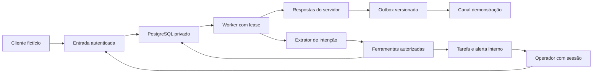

# Modelo de ameaças — atendimento virtual

## Executive summary

O atendimento acrescenta entrada de cliente, ferramentas com efeitos e controle humano ao CRM existente. Os maiores riscos são cruzar organizações, confirmar reservas sem execução válida, disputar capacidade e enviar uma resposta depois de um humano assumir. A entrega inicia somente com contas `DEMO` e identificadores `demo:`, sem rede para destinatários. Evolução para WhatsApp real exige outra ativação e testes autorizados; o conector Evolution dos avisos internos permanece separado. Evidências: `src/server/atendimento-canal.ts`, `src/modules/crm/services/virtual-runtime.ts` e migração `20261103010000_atendimento_virtual`.

## Scope and assumptions

- Contexto confirmado pelo pedido: sistema Vitaliano existente, Auth.js, PostgreSQL privado, acesso público HTTPS pelo Dokploy, isolamento por organização e unidade; primeiro canal é demonstração.
- Escopo: rotas CRM de atendimento, fatos aprovados, identidade mínima, fila, ferramentas de reserva, inbox, pausas, tarefas, alertas internos, métricas e extrator de intenção opcional.
- Fora do escopo de ativação: WhatsApp real, mudanças de permissões existentes, acesso administrativo pelo cliente, pagamentos, disparos em massa, ingestão de arquivos e transcrição externa de áudio.
- A sessão do operador é montada pelo servidor. Um identificador de canal verificado é sinal de posse e não autorização para entrar no painel ou alterar cadastro sensível.
- O executor passado a `processVirtualQueue` é código confiável da aplicação; o modelo recebe texto não confiável e devolve apenas o esquema estrito de intenção. Não recebe autorização para produzir texto livre de confirmação.
- Questões condicionais antes do canal real: provedor oficial, conta/número autorizados, política organizacional de retenção de conteúdo real, custos e limites contratados. Não são necessárias para executar a demonstração com dados fictícios.

## System model

### Primary components

Next.js serve a interface autenticada e a API CRM; serviços do CRM controlam a conversa, a fila persistida, os fatos e as reservas. PostgreSQL mantém eventos, leases, versões, efeitos, outbox e auditoria. O canal de demonstração aceita somente identificadores fictícios. O extrator de intenção opcional fica no servidor, separado do renderizador que forma respostas a partir de resultados reais. Evidências: `src/app/api/crm/virtual/[[...path]]/route.ts`, `src/modules/crm/services/virtual-agent.ts`, `src/server/ia/atendimento.ts`.

### Data flows and trust boundaries

- Navegador autenticado → API CRM: HTTPS, sessão Auth.js, unidade ativa, permissões `crm.ver`/`crm.editar`/`crm.gerenciar`, origem de escrita, limite de corpo e de tentativas. IDs enviados não ampliam o escopo. Evidências: handler CRM, `virtualAccess`, `authorizeVirtual`.
- Canal → eventos persistidos: conta determina organização/unidade; demonstração recusa telefone real, grupo, bot e evento de entrega como fala. Deduplicação por conta + ID externo. Evidências: `receiveVirtualInbound`, `AvInboundEvent`.
- Mensagens → extrator de intenção: texto é dado; schema estrito não aceita tenant, ferramenta arbitrária, resposta livre, SQL ou autorização. Política do servidor prevalece para assuntos sensíveis. Evidências: `virtual-agent-plan.ts`, `virtual-agent.ts`.
- Agente → ferramentas → PostgreSQL: schemas estritos, escopo de conta/conversa, lease e versão vigentes; confirmação textual explícita e resumo com token temporário para reservas. Advisory lock transacional revalida a capacidade. Evidências: `virtual-tools.ts`, `assertVirtualTurn`, `av_reservation_slot`.
- Operador → takeover/pausa → fila/outbox: transação serializada incrementa a versão, desabilita o agente e invalida saída pendente. A finalização do turno confere novamente a versão. Evidência: `actOnVirtualConversation`.
- Outbox → canal: cada intenção tem correlação; aceitação e entrega são campos distintos; alegações carregam execução, ação e objeto validados. Resultado incerto é reconciliado por ID. Evidências: `deliverVirtualOutbox`, `validateVirtualClaims`, `AvMessageOutbox`.
- Escalação → notificação interna → reconhecimento humano: tarefa durável precede a confirmação ao cliente; destinatário precisa de acesso à mesma unidade; falha de alerta permanece visível; ack tem autor e horário. Evidências: `createVirtualEscalation`, `notifyVirtualEscalation`, `AvEscalation`.

#### Diagram

## Assets and security objectives

| Ativo                                | Por que importa                                             | Objetivo |
| ------------------------------------ | ----------------------------------------------------------- | -------- |
| Identidade CRM e preferências        | Evitar revelar dados de outra pessoa ou unidade             | C/I      |
| Reservas e capacidade por horário    | Evitar duplicação, cancelamento indevido e lotação excedida | I/A      |
| Controle humano e estado da conversa | Impedir fala automática durante atendimento manual          | I        |
| Fatos aprovados e links oficiais     | Impedir preço, promoção e destino inventados                | I        |
| Segredos e sessão                    | Impedir acesso ao painel ou ao provedor                     | C/I      |
| Execuções, outbox e tarefas          | Rastrear efeitos e recuperar incerteza sem repetição        | I/A      |
| Orçamento e recursos                 | Conter loops e falhas de integração                         | A        |

## Attacker model

### Capabilities

Cliente pode enviar texto malicioso, instruções conflitantes e sequências de mensagens. Um operador de uma unidade pode tentar trocar IDs ou repetir requisições. Um agente externo pode tentar forjar ou repetir eventos. Modelo pode interpretar incorretamente intenção, datas e campos.

### Non-capabilities

Cliente não escolhe organização, conta, unidade, permissões, configuração ou SQL. Não recebe sessão administrativa por possuir o telefone. Nesta entrega não existe transporte para enviar mensagens reais nem ingestão de arquivo remoto; portanto ataques a decodificadores de mídia e SSRF de download não são superfícies ativadas.

## Entry points and attack surfaces

A configuração de conta em `src/modules/crm/services/virtual-settings.ts` exige gestor, confere os acessos atuais do destinatário e invalida turnos em andamento antes de salvar limites/pausa. A entrada de máquina `src/app/api/atendimento/webhook/route.ts` usa HMAC do corpo original, segredo privado próprio, limite de bytes e taxa; ausência de segredo mantém a rota fechada. Esses dois caminhos não ampliam a conta DEMO para um canal real.

| Superfície                  | Acesso                        | Fronteira                | Observação                                                | Evidência                                |
| --------------------------- | ----------------------------- | ------------------------ | --------------------------------------------------------- | ---------------------------------------- |
| Inbox, ações e demonstração | Sessão CRM                    | Navegador/servidor       | Permissões e unidade ativa repetidas no serviço           | `virtual-inbox.ts`, `virtual-runtime.ts` |
| Base e grade                | Gestor CRM                    | Operador/fatos aprovados | Rascunho separado de aprovação e capacidade               | `virtual-knowledge.ts`                   |
| Mensagem fictícia           | Conta DEMO autorizada         | Cliente/evento           | ID único por conta, schema estrito, limite de texto       | `receiveVirtualInbound`                  |
| Intenção extraída           | Configuração privada opcional | Texto/modelo/servidor    | Sem texto livre de saída nem escolha de escopo            | `virtual-agent-plan.ts`                  |
| Ferramentas                 | Turno vigente                 | Agente/efeito            | Autorização derivada, confirmação, idempotência           | `virtual-tools.ts`                       |
| Worker e outbox             | Processo do servidor          | Concorrência/efeito      | Lease recuperável, versão e correlação                    | `processVirtualQueue`                    |
| Avisos Evolution anteriores | Webhook separado              | Provedor/avisos internos | Nenhuma conversa de cliente é habilitada por esta entrega | `src/connectors/whatsapp/README.md`      |

## Top abuse paths

1. Cliente informa nome/telefone alheio → tenta obter cadastro → lookup restringe vínculo verificado da conta → dados de terceiros permanecem fora do contexto.
2. Operador troca `storeId` ou ID de conversa → tenta acessar outra organização → sessão/unidade e FKs compostas recusam acesso/escrita.
3. Mensagem manda ignorar regras e confirmar reserva → modelo tenta devolver texto/ação administrativa → schema de intenção e política do servidor recusam; confirmação depende do resumo e ferramenta.
4. Duas conversas consultam a última vaga → confirmam ao mesmo tempo → lock de horário e revalidação serializam a disputa; somente capacidade efetiva é confirmada.
5. Provedor ou navegador repete requisição → tenta duplicar evento, reserva ou resposta → chaves únicas e operações idempotentes recuperam o mesmo efeito.
6. Humano assume durante geração → resposta antiga tenta sair → versão e pausa invalidam turno/outbox antes do envio.
7. Falha de modelo gera repetição/custo → limite de ferramentas, tokens, tempo e orçamento interrompe a automação → tarefa rastreável substitui promessa de sucesso.
8. Escalação não tem destinatário autorizado → alerta falha → tarefa e erro continuam no painel; reenvio não cria outra tarefa; ack identifica responsável.

## Threat model table

| Threat ID | Threat source                               | Prerequisites                                   | Threat action                                              | Impact                                      | Impacted assets        | Existing controls (evidence)                                                                                                       | Gaps                                                  | Recommended mitigations                                                                     | Detection ideas                                                       | Likelihood                                | Impact severity                                       | Priority |
| --------- | ------------------------------------------- | ----------------------------------------------- | ---------------------------------------------------------- | ------------------------------------------- | ---------------------- | ---------------------------------------------------------------------------------------------------------------------------------- | ----------------------------------------------------- | ------------------------------------------------------------------------------------------- | --------------------------------------------------------------------- | ----------------------------------------- | ----------------------------------------------------- | -------- |
| TM-001    | Cliente/operador                            | Entrada ou sessão limitada                      | Trocar unidade/conta/contato para ler PII                  | Exposição entre organizações                | CRM/conversas          | Sessão, escopo mínimo, FKs compostas (`virtual-runtime.ts`, migração)                                                              | Novas tabelas não alegam RLS                          | Preservar autorização em todo novo endpoint e testar FKs                                    | 403/404 e auditoria sem PII                                           | Baixa com controles; IDs são manipuláveis | Alto: dados de terceiros                              | medium   |
| TM-002    | Remetente externo                           | Webhook real futuro                             | Forjar conta, evento ou repetir entrega                    | Conversa/efeito falso                       | Eventos/outbox         | DEMO-only, dedupe, verificador HMAC (`atendimento-canal.ts`)                                                                       | Provedor real desativado e não homologado             | Validar assinatura sobre bytes originais, conta/destinatário e callback em teste autorizado | Autenticidade inválida e duplicatas                                   | Baixa agora; média se ativação incompleta | Alto para canal real                                  | medium   |
| TM-003    | Cliente/modelo                              | Texto adversarial                               | Injetar instrução, ferramenta ou sucesso inventado         | Ação indevida/informação falsa              | Base/reservas/segredos | Intenção estrita, política do servidor, texto de efeito renderizado pelo resultado (`virtual-agent.ts`, `virtual-tools.ts`)        | Extrator pode errar campos                            | Perguntar campo ambíguo e exigir confirmação vigente; não ampliar contrato                  | Erro de schema, alegação bloqueada, falhas de ferramenta              | Média: entrada sempre não confiável       | Alto se reserva/cadastro afetado                      | medium   |
| TM-004    | Concorrência/retry                          | Duas réplicas ou clique repetido                | Duplicar reserva ou exceder última vaga                    | Atendimento inválido                        | Reservas/capacidade    | Locks transacionais, revalidação e idempotência (`virtual-tools.ts`)                                                               | Efeitos de futuro provedor não são transação do banco | Conciliar por ID; nunca repetir timeout cegamente                                           | Reserva por chave e ocupação por horário                              | Baixa após testes locais de corrida       | Alto operacional                                      | medium   |
| TM-005    | Corrida com operador                        | Geração em andamento                            | Enviar resposta após takeover                              | Atendimento conflitante                     | Controle humano/outbox | Versão, lease, invalidação transacional (`virtual-runtime.ts`)                                                                     | Futura rede exige rechecagem junto ao envio           | Preservar gate no transportador real; testar takeover durante envio                         | Turnos descartados e pausa com autor                                  | Baixa com transporte fictício síncrono    | Médio; alto para promessas reais                      | medium   |
| TM-006    | Cliente/falha de modelo                     | Muitas mensagens ou provedor lento              | Criar loop, custo ou fila presa                            | Indisponibilidade                           | Orçamento/fila         | Debounce máximo, lease, tentativas, limites/circuit breaker (`virtual-runtime.ts`, `virtual-agent.ts`)                             | Volume real ainda não medido                          | Calibrar cotas antes da ativação e monitorar latência/atraso                                | Saúde de fila, erros, tokens/custo, tarefas                           | Média: falhas de rede são normais         | Médio em demonstração                                 | medium   |
| TM-007    | Configuração incompleta                     | Sem destinatário de alerta                      | Encaminhamento sem acompanhamento                          | Cliente esquecido                           | Escalações             | Tarefa durável, erro visível, retry e ack (`createVirtualEscalation`)                                                              | Aceitação interna não prova leitura                   | Exigir responsável e prazo operacional no rollout real                                      | Pendências sem ack, alertas falhos                                    | Média até configurar equipe               | Médio                                                 | medium   |
| TM-008    | Operador sem privilégio ou leitor de backup | Acesso limitado ao painel ou à cifra armazenada | Obter chave Gemini ou transferir cifra entre unidades      | Uso indevido de cota e quebra de isolamento | Credencial/custo       | Gestor obrigatório, AES-GCM com AAD por organização/unidade, DTO sem chave/cifra (`virtual-model.ts`, `credencial-atendimento.ts`) | Rotação do segredo exige preservar a chave efetiva    | Manter chave de cifra estável e backup privado; recadastrar após falha de leitura           | Erro de decifragem e auditoria de revisão sem segredo                 | Baixa com os controles testados           | Alto para cota/credencial real                        | medium   |
| TM-009    | Concorrência de configuração                | Teste ou turno capturou revisão antiga          | Ativar teste antigo ou chamar modelo após salvar/desativar | Uso de configuração revogada                | Configuração/custo     | Teste por revisão, lock de modelo antes do lease/orçamento, releitura antes da rede (`virtual-agent.ts`, `virtual-model.ts`)       | Chave real não foi testada nesta validação            | Ativar somente revisão atual aprovada; verificar teste privado no painel                    | Revisão alterada, probe obsoleto, custo reservado e chamada bloqueada | Baixa após teste da corrida               | Médio enquanto somente mensagens fictícias são usadas | medium   |

## Criticality calibration

- `critical`: leitura irrestrita entre organizações ou execução remota sem autenticação. Não identificadas nesta revisão; seriam impeditivas de publicação.
- `high`: efetuar/cancelar reserva de outro cliente; expor sessão/chave; habilitar canal real sem autorização. Exigem correção ou desativação do caminho afetado.
- `medium`: atraso rastreável por falha de alerta; loop contido por limites; interpretação incorreta que termina em pergunta/escalada. O modo fictício limita o dano.
- `low`: metadado de saúde sem PII; detalhe visual sem efeito em autorização; duplicata contada sem repetição de ação.

## Focus paths for security review

Os testes de regressão de configuração também cobrem usuário sem privilégio, destinatário de outra organização, permissão suspensa e pausa de conta enquanto a IA gera. O teste da fronteira do modelo substitui a resposta HTTP por JSON malicioso; a extração real recusa texto de sucesso/tenant extra sem produzir reserva.

| Caminho                                                                     | Motivo                                                | Ameaças                            |
| --------------------------------------------------------------------------- | ----------------------------------------------------- | ---------------------------------- |
| `src/app/api/crm/virtual/[[...path]]/route.ts`                              | Sessão, origem, limites e dispatch                    | TM-001/TM-002                      |
| `src/modules/crm/services/virtual-runtime.ts`                               | Locks, lease, takeover, claim, tarefa e outbox        | TM-001/TM-004/TM-005/TM-006/TM-007 |
| `src/modules/crm/services/virtual-tools.ts`                                 | Confirmação, propriedade e capacidade da reserva      | TM-003/TM-004                      |
| `src/modules/crm/services/virtual-agent-plan.ts`                            | Contrato de saída do modelo                           | TM-003                             |
| `src/modules/crm/services/virtual-agent.ts`                                 | Renderização de sucesso e orçamento                   | TM-003/TM-006                      |
| `src/modules/crm/services/virtual-knowledge.ts`                             | Aprovação, validade, links e grade                    | TM-003/TM-004                      |
| `src/modules/crm/services/virtual-inbox.ts`                                 | DTO mínimo, filtros, paginação e demonstração         | TM-001/TM-007                      |
| `src/server/atendimento-canal.ts`                                           | Bloqueio de destinatário real e autenticação do canal | TM-002/TM-005                      |
| `src/server/ia/atendimento.ts`                                              | Segredos, endpoint e consumo do extrator opcional     | TM-003/TM-006                      |
| `prisma/schema/migrations/20261103010000_atendimento_virtual/migration.sql` | FKs compostas e invariantes do banco                  | TM-001/TM-004                      |

## Notes on use

### Fronteira de transporte externo

Uma chamada de rede não pode participar da transação PostgreSQL como se o provedor pudesse desfazer seu envio. Se o provedor aceitar e o processo ou a transação falhar antes de gravar a aceitação, voltar a tratar a saída como `PENDING` permite duplicação. Esse risco ficava inativo no adaptador local; a saída foi refatorada antes de acrescentar qualquer transporte real.

O dispatcher confere conta/versão/pausa e persiste `SENDING` com lease e correlação em uma transação curta; chama o adaptador fora da transação e finaliza somente com o mesmo token de lease. `SENDING` vencido significa resultado potencialmente incerto e exige consulta pela correlação, nunca outro envio. Uma réplica antiga não pode sobrescrever a conciliação feita pela nova. Evidências: `deliverVirtualOutbox`, migração `20261103020000_outbox_claim` e os três testes de fronteira em `virtual.integracao.ts`.

Takeover invalida o que ainda está em geração ou aguardando envio e deve concluir sem esperar uma chamada de rede presa. Uma mensagem já entregue ao provedor pode ser aceita depois do takeover; esse resultado precisa ser registrado como histórico, sem prometer retração e sem reenviar. Os testes usam adaptadores fictícios e interrupção controlada no limite entre aceitação e gravação; isso ainda não homologa um provedor real.

### Ativação real continua separada

O CHECK `av_channel_demo_only`, os filtros de conta DEMO e os identificadores `demo:` não devem ser removidos como atalho de configuração. Ainda é necessário um contrato real de canal, conta/unidade confiáveis, webhook específico do fornecedor, identidade CRM verificada, fonte operacional aprovada e teste de envio explicitamente autorizado. A presença de uma integração Evolution para avisos internos não autoriza importar as conversas pessoais desse número nem substituir seu webhook. Habilitar Gemini em conversas fictícias do painel é uma etapa independente de conectar WhatsApp.

### Gemini no painel privado

O usuário escolheu Gemini com credencial inserida no painel HTTPS. `changeVirtualModel` exige gestor/unidade ativa; a chave é cifrada por AES-256-GCM e AAD de organização/unidade antes de persistir. `safeVirtualModelStatus` devolve somente presença/estado, revisão, tarifas e teste. Chave e ciphertext não vão para DTO nem auditoria. Um backup da cifra sem a chave estável não permite decifrar; uma cifra de outra unidade falha por autenticação. Evidências: `virtual-model.ts`, `src/server/ia/credencial-atendimento.ts` e migração `20261103021000_virtual_model_configuration`.

Salvar qualquer mudança desativa o modelo e invalida o teste. A ativação exige teste `PASSED`, mesma revisão e validade de 30 dias. Probes têm correlação idempotente, limite de três por hora/unidade e reserva de custo anterior à rede; falha/timeout conservam o débito. A conclusão de probe antigo não altera a revisão nova. O orçamento de turno relê a configuração vigente sob lock antes de usar a credencial; a corrida com snapshot antigo é testada sem invalidar artificialmente o lease da conversa.

Probe `RUNNING` abandonado por mais de 60 segundos é reconciliado como `FAILED/MODEL_TEST_TIMEOUT` ao repetir o mesmo ID, sem chamar novamente a API ou zerar a reserva de custo. A finalização atrasada não pode reabrir o probe falho; uma nova tentativa requer ID explícito e passa novamente pelas cotas e pelo orçamento.

Fallback de ambiente só existe com `AV_MODEL_ORGANIZATION_ID` e `AV_MODEL_STORE_ID` correspondentes. A chave global não é adotada no primeiro cadastro nem disponibilizada para outra organização. Os ensaios de modelo e catálogo usam `fetch` substituído e credenciais fictícias; não comprovam uma chave Google válida ou atendimento com IA real. Essa comprovação depende de o usuário inserir a chave privadamente, executar o teste e ativar a mesma revisão no painel.

Revisão cobre entradas ativadas, fronteiras, modelo, efeitos e operador. CI/build não recebe dados do cliente; testes usam banco local `_test` e dados fictícios. As premissas de ambiente, autenticação e demonstração vieram do pedido completo e das regras do projeto, sem necessidade de pedir credenciais ou dados privados. A matriz de evidências e os limites dos testes estão em `docs/atendimento-virtual-aceite.md`. Este documento não comprova entrega de mensagem ou funcionamento de WhatsApp real.

Referências consultadas: [locks explícitos PostgreSQL](https://www.postgresql.org/docs/current/explicit-locking.html), [documentação WhatsApp Business Platform](https://developers.facebook.com/docs/whatsapp/) e [preços oficiais WhatsApp](https://whatsappbusiness.com/products/platform-pricing/). As páginas técnicas Meta devolveram HTTP 429 nesta revisão; a ativação real deve conferir novamente a documentação vigente do provedor escolhido. Não se adotou SDK arquivado como contrato de produção.
