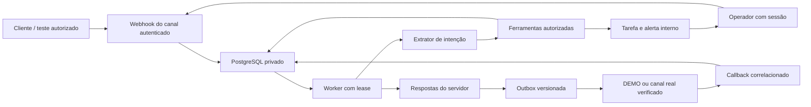

# Modelo de ameaças — atendimento virtual

## Executive summary

O atendimento acrescenta entrada de cliente, ferramentas com efeitos e controle humano ao CRM existente. Os maiores riscos são cruzar organizações, confirmar reservas sem execução válida, disputar capacidade e enviar depois de um humano assumir. A primeira entrega foi DEMO. A continuação inclui contas EVOLUTION e META, criadas inativas, com credenciais privadas, revisão, teste de entrega e observação humana antes da ativação. A integração Evolution dos avisos internos permanece separada. Os testes desta revisão usam apenas PostgreSQL local e adaptadores/HTTP fictícios; não comprovam entrega real. Evidências: `virtual-channels.ts`, `virtual-runtime.ts`, `atendimento-contas.ts` e migração `20261103030000_severina_canais`.

## Scope and assumptions

### Revisão de usabilidade e conexão por QR — 03/11/2026

A preparação rápida exige `AV_EVOLUTION_API_KEY`, uma chave administrativa privada
configurada explicitamente para a criação. O token individual dos avisos não é
alternativa para essa chave. Seu uso só é permitido após conferir
permissões atuais e o vínculo único da instância original com a organização. O
gestor precisa de `crm.gerenciar` na unidade e de `assistente.conectar` no escopo
da conexão original; acesso apenas à loja B não libera o recurso da loja A, e uma
conexão de rede exige autorização de rede. Vínculo ausente, estrangeiro, ambíguo
ou revogado fecha a opção rápida. GET retorna apenas disponibilidade booleana.
Evidência: `virtual-evolution-config.ts` e sua integração com banco local.

`quickSetup` gera identificador e segredo novos no servidor e salva somente uma
conta inativa, cifrada. `connect` confirma a existência, cria apenas após 404,
configura o webhook antes do QR e cerca cada etapa pela revisão atual. Um destino
estrangeiro não é substituído. Erro explícito em HTTP 200 também é falha; timeout
não repete a criação automaticamente. `status` só consulta o provedor, registra
mudanças e não gera QR, envia mensagem ou ativa a IA. A leitura do QR é privada,
limitada por tempo e descartada ao trocar unidade/conta. Nenhuma credencial ou QR
real foi utilizado na validação visual.

Duas abas não podem preparar simultaneamente a mesma instância: um lease durável
de dois minutos em `AvChannelConnection` cerca `connect`, QR e ações avançadas que
alteram o provedor. A aquisição usa o relógio do banco; cada etapa confere o dono,
a validade e a revisão. Salvar outra revisão preserva a exclusão até a execução
anterior terminar ou expirar. HTTP fica fora da transação, e a finalização só
libera o próprio lease. Isso evita duas criações após consultas concorrentes de
ausência, sem depender de idempotência oferecida pelo Evolution.

- Contexto confirmado pelo pedido: sistema Vitaliano existente, Auth.js, PostgreSQL privado, acesso público HTTPS pelo Dokploy, isolamento por organização e unidade; primeiro canal é demonstração.
- Escopo: telas de atendimento dentro de Severina, APIs autenticadas, configuração das duas opções de canal, fatos/políticas aprovados, identidade mínima, fila, reservas, inbox, pausas, tarefas, alertas, métricas e extrator de intenção.
- Fora do escopo dos ensaios executados: envio a cliente real, mudança das permissões existentes, acesso administrativo pelo cliente, pagamentos, disparos em massa, ingestão de arquivo e transcrição externa de áudio.
- A sessão do operador é montada pelo servidor. Um identificador de canal verificado é sinal de posse e não autorização para entrar no painel ou alterar cadastro sensível.
- O executor passado a `processVirtualQueue` é código confiável da aplicação; o modelo recebe texto não confiável e devolve apenas o esquema estrito de intenção. Não recebe autorização para produzir texto livre de confirmação.
- Opções de provedor foram explicitamente escolhidas pelo usuário: Evolution e Meta oficial. Credenciais e destinatário de teste são informados somente no painel privado. Ativação ainda depende de conta/número autorizados, fonte operacional real aprovada, Gemini testado/ativo, retorno autenticado de entrega, observação do teste, retenção e limites contratados.

## System model

### Resolução do nome sem promoção de identidade

`virtual-customer-name.ts` separa nome e vínculo: somente identidades CRM
verificadas, ativas e não ambíguas podem produzir `contactId`/`known`. Contato do
WhatsApp, perfil e nome histórico fornecem apenas rótulos. A consulta usa
organização, unidade, conta e telefone atestado; nome ou telefone escritos no
texto não são um seletor de identidade. Preferência corrigida pelo cliente tem
prioridade. Dois cadastros conflitantes não são fundidos nem escolhidos ao acaso.

`virtual-name-worker.ts` consulta somente a instância e o telefone da conversa,
com HTTP fora da transação, lease recuperável, limite de tentativas e revisão
conferida antes da gravação. Cache de perfil conserva o horário de origem e não
regride por evento antigo. Uma correção durante HTTP é relida sob lock e vence o
retorno. A mudança de `contactId` invalida versão/lease de geração; ferramentas
também recusam snapshot de contato divergente. O worker preserva pausa, takeover,
estado, fila de mensagens e autorização de envio.

Nome segue saneamento antes de persistir cache, preencher rascunho ou mostrar
origem. Auditoria registra fonte e flags, sem nomes, telefones ou credenciais.
`PROVIDER_CONTACT` não afirma que um `pushName` ambíguo veio da agenda. Sugestão
CRM não verificada não permite prefill de reserva, enquanto perfil válido pode
ser usado somente para o nome no resumo que exige confirmação. A resolução não
cria contatos, identidades verificadas, reservas, saídas ou chamadas pagas.

### Importação histórica de WhatsApp

O gestor solicita uma importação apenas da conta Evolution verificada da unidade
ativa (`virtual-history.ts`). O worker revalida ator, organização, unidade e
revisão antes e depois da leitura externa. O adaptador confirma o UUID/nome da
instância e recusa registros de outra origem. HTTP ocorre fora da transação;
lease, requestId e revisão cercam a gravação. Repetir um requestId já auditado é
inerte, inclusive após outro pedido. Página repetida ou sem avanço interrompe o
processo; teto por etapa e três tentativas limitam consumo de recursos.

A fronteira histórica não usa `receiveVirtualInbound`. Mensagens recebem
`source=HISTORY` e `processedAt`, conservam o timestamp e não agendam o agente,
criam janela de envio, identidade CRM verificada ou efeitos externos. Uma fala
antiga contendo uma ordem continua sendo dado de histórico. O webhook reconhece
uma mensagem já importada e não a enfileira novamente. A importação usa os locks
da conta/conversa; preserva takeover, pausas, estado e versão existentes, e não
regride o horário da última mensagem. IDs de saída brutos já gravados pela outbox
também entram na deduplicação. A leitura de páginas anteriores valida escopo no
servidor e cursor estrito, sem acesso a outra conversa ou unidade.

O painel separa a demonstração dos números reais e marca mensagens importadas
sem atribuir entrega ou leitura. Grupos, LID não resolvido e conteúdo de arquivos
não atravessam essa fronteira. Segredos são mascarados antes de persistir texto;
logs e auditoria registram estado/contagens, sem corpo ou credenciais. O histórico
que a Evolution não persistiu não pode ser considerado recuperado. Esses limites
são exibidos junto da sincronização, independentemente da ativação da IA.

### Primary components

Next.js serve a interface autenticada e a API CRM; serviços do CRM controlam a conversa, a fila persistida, os fatos e as reservas. PostgreSQL mantém eventos, leases, versões, efeitos, outbox e auditoria. O canal de demonstração aceita somente identificadores fictícios. O extrator de intenção opcional fica no servidor, separado do renderizador que forma respostas a partir de resultados reais. Evidências: `src/app/api/crm/virtual/[[...path]]/route.ts`, `src/modules/crm/services/virtual-agent.ts`, `src/server/ia/atendimento.ts`.

### Data flows and trust boundaries

- Navegador autenticado → API CRM: HTTPS, sessão Auth.js, unidade ativa, permissões `crm.ver`/`crm.editar`/`crm.gerenciar`, origem de escrita, limite de corpo e de tentativas. IDs enviados não ampliam o escopo. Evidências: handler CRM, `virtualAccess`, `authorizeVirtual`.
- Canal → eventos persistidos: conta determina organização/unidade; demonstração recusa telefone real, grupo, bot e evento de entrega como fala. Deduplicação por conta + ID externo. Evidências: `receiveVirtualInbound`, `AvInboundEvent`.
- Mensagens → extrator de intenção: texto é dado; schema estrito não aceita tenant, ferramenta arbitrária, resposta livre, SQL ou autorização. Política do servidor prevalece para assuntos sensíveis. Evidências: `virtual-agent-plan.ts`, `virtual-agent.ts`.
- Horário do provedor → interpretação relativa: mensagens carregam texto e data de origem juntos, em ordem; “amanhã” usa a referência do evento no fuso da unidade, enquanto validade/custos usam o relógio atual. Histórico de mais de 24 horas e mensagem real sem horário não disparam automação. Evidências: `virtualReferenceTime`, `receiveVirtualInbound`, `virtual-temporal.integracao.ts`.
- Agente → ferramentas → PostgreSQL: schemas estritos, escopo de conta/conversa, lease e versão vigentes; confirmação textual explícita e resumo com token temporário para reservas. Advisory lock transacional revalida a capacidade. Evidências: `virtual-tools.ts`, `assertVirtualTurn`, `av_reservation_slot`.
- Operador → takeover/pausa → fila/outbox: transação serializada incrementa a versão, desabilita o agente e invalida saída pendente. A finalização do turno confere novamente a versão. Evidência: `actOnVirtualConversation`.
- Outbox → canal: cada intenção tem correlação; aceitação e entrega são campos distintos; alegações carregam execução, ação e objeto validados. Resultado incerto é reconciliado por ID. Evidências: `deliverVirtualOutbox`, `validateVirtualClaims`, `AvMessageOutbox`.
- Escalação → notificação interna → reconhecimento humano: tarefa durável precede a confirmação ao cliente; destinatário precisa de acesso à mesma unidade; falha de alerta permanece visível; ack tem autor e horário. Evidências: `createVirtualEscalation`, `notifyVirtualEscalation`, `AvEscalation`.

#### Diagram

## Assets and security objectives

| Ativo                                | Por que importa                                             | Objetivo |
| ------------------------------------ | ----------------------------------------------------------- | -------- |
| Identidade CRM e preferências        | Evitar revelar dados de outra pessoa ou unidade             | C/I      |
| Reservas e capacidade por horário    | Evitar duplicação, cancelamento indevido e lotação excedida | I/A      |
| Controle humano e estado da conversa | Impedir fala automática durante atendimento manual          | I        |
| Fatos aprovados e links oficiais     | Impedir preço, promoção e destino inventados                | I        |
| Segredos e sessão                    | Impedir acesso ao painel ou ao provedor                     | C/I      |
| Execuções, outbox e tarefas          | Rastrear efeitos e recuperar incerteza sem repetição        | I/A      |
| Orçamento e recursos                 | Conter loops e falhas de integração                         | A        |

## Attacker model

### Capabilities

Cliente pode enviar texto malicioso, instruções conflitantes e sequências de mensagens. Um operador de uma unidade pode tentar trocar IDs ou repetir requisições. Um agente externo pode tentar forjar ou repetir eventos. Modelo pode interpretar incorretamente intenção, datas e campos.

### Non-capabilities

Cliente não escolhe organização, conta, unidade, permissões, configuração ou SQL. Não recebe sessão administrativa por possuir o telefone. Não há ingestão de arquivo remoto; decodificadores de mídia e SSRF de download continuam fora da superfície ativada. Configuração Evolution introduz uma superfície de requisição HTTP administrativa: somente destinos explicitamente autorizados no servidor podem ser usados, sem credenciais na URL ou redirecionamento para outro host.

## Entry points and attack surfaces

A configuração de conta em `virtual-settings.ts` exige gestor, confere o acesso atual do destino e invalida turnos antes de salvar limites/pausa. Ativar uma conta real exige o fluxo de Conexões: essa tela não contorna as provas. O endpoint DEMO mantém HMAC próprio e recusa destinatário real. Entradas dos provedores reais usam rotas distintas, conta vinculada e atestado interno do provedor após autenticação. O webhook legado de avisos internos é preservado.

| Superfície                  | Acesso                        | Fronteira                | Observação                                                | Evidência                                |
| --------------------------- | ----------------------------- | ------------------------ | --------------------------------------------------------- | ---------------------------------------- |
| Inbox, ações e demonstração | Sessão CRM                    | Navegador/servidor       | Permissões e unidade ativa repetidas no serviço           | `virtual-inbox.ts`, `virtual-runtime.ts` |
| Base e grade                | Gestor CRM                    | Operador/fatos aprovados | Rascunho separado de aprovação e capacidade               | `virtual-knowledge.ts`                   |
| Mensagem fictícia           | Conta DEMO autorizada         | Cliente/evento           | ID único por conta, schema estrito, limite de texto       | `receiveVirtualInbound`                  |
| Intenção extraída           | Configuração privada opcional | Texto/modelo/servidor    | Sem texto livre de saída nem escolha de escopo            | `virtual-agent-plan.ts`                  |
| Ferramentas                 | Turno vigente                 | Agente/efeito            | Autorização derivada, confirmação, idempotência           | `virtual-tools.ts`                       |
| Worker e outbox             | Processo do servidor          | Concorrência/efeito      | Lease recuperável, versão e correlação                    | `processVirtualQueue`                    |
| Avisos Evolution anteriores | Webhook separado              | Provedor/avisos internos | Nenhuma conversa de cliente é habilitada por esta entrega | `src/connectors/whatsapp/README.md`      |

## Top abuse paths

1. Cliente informa nome/telefone alheio → tenta obter cadastro → lookup restringe vínculo verificado da conta → dados de terceiros permanecem fora do contexto.
2. Operador troca `storeId` ou ID de conversa → tenta acessar outra organização → sessão/unidade e FKs compostas recusam acesso/escrita.
3. Mensagem manda ignorar regras e confirmar reserva → modelo tenta devolver texto/ação administrativa → schema de intenção e política do servidor recusam; confirmação depende do resumo e ferramenta.
4. Duas conversas consultam a última vaga → confirmam ao mesmo tempo → lock de horário e revalidação serializam a disputa; somente capacidade efetiva é confirmada.
5. Provedor ou navegador repete requisição → tenta duplicar evento, reserva ou resposta → chaves únicas e operações idempotentes recuperam o mesmo efeito.
6. Humano assume durante geração → resposta antiga tenta sair → versão e pausa invalidam turno/outbox antes do envio.
7. Falha de modelo gera repetição/custo → limite de ferramentas, tokens, tempo e orçamento interrompe a automação → tarefa rastreável substitui promessa de sucesso.
8. Escalação não tem destinatário autorizado → alerta falha → tarefa e erro continuam no painel; reenvio não cria outra tarefa; ack identifica responsável.

## Threat model table

| Threat ID | Threat source                               | Prerequisites                                   | Threat action                                              | Impact                                      | Impacted assets           | Existing controls (evidence)                                                                                                       | Gaps                                                | Recommended mitigations                                                           | Detection ideas                                                       | Likelihood                                | Impact severity                                       | Priority |
| --------- | ------------------------------------------- | ----------------------------------------------- | ---------------------------------------------------------- | ------------------------------------------- | ------------------------- | ---------------------------------------------------------------------------------------------------------------------------------- | --------------------------------------------------- | --------------------------------------------------------------------------------- | --------------------------------------------------------------------- | ----------------------------------------- | ----------------------------------------------------- | -------- |
| TM-001    | Cliente/operador                            | Entrada ou sessão limitada                      | Trocar unidade/conta/contato para ler PII                  | Exposição entre organizações                | CRM/conversas             | Sessão, escopo mínimo, FKs compostas (`virtual-runtime.ts`, migração)                                                              | Novas tabelas não alegam RLS                        | Preservar autorização em todo novo endpoint e testar FKs                          | 403/404 e auditoria sem PII                                           | Baixa com controles; IDs são manipuláveis | Alto: dados de terceiros                              | medium   |
| TM-002    | Remetente externo                           | Endpoint público do provedor                    | Forjar evento ou recibo                                    | Conversa/entrega falsa                      | Eventos/outbox            | Conta/revisão/destinatário, autenticação do provedor, digest/dedupe e provas (`atendimento-contas.ts`)                             | JWT Evolution não assina corpo; teste real pendente | HTTPS/rede restrita e prova de entrega autorizada por conta                       | Falhas de autenticação, conflito de recibo                            | Média em canal público                    | Alto                                                  | high     |
| TM-003    | Cliente/modelo                              | Texto adversarial                               | Injetar instrução, ferramenta ou sucesso inventado         | Ação indevida/informação falsa              | Base/reservas/segredos    | Intenção estrita, política do servidor, texto de efeito renderizado pelo resultado (`virtual-agent.ts`, `virtual-tools.ts`)        | Extrator pode errar campos                          | Perguntar campo ambíguo e exigir confirmação vigente; não ampliar contrato        | Erro de schema, alegação bloqueada, falhas de ferramenta              | Média: entrada sempre não confiável       | Alto se reserva/cadastro afetado                      | medium   |
| TM-004    | Concorrência/retry                          | Réplicas e dois provedores                      | Duplicar efeito/exceder vaga                               | Atendimento inválido                        | Reservas/capacidade       | Lock compartilhado da unidade para canais reais, confirmação e idempotência (`atendimento-reservas.ts`, `virtual-tools.ts`)        | Transporte não é transação do banco                 | Conciliar por ID sem repetição cega                                               | Chave única e ocupação compartilhada                                  | Baixa após corrida local                  | Alto operacional                                      | medium   |
| TM-005    | Corrida com operador                        | Geração/HTTP em andamento                       | Enviar após takeover                                       | Atendimento conflitante                     | Controle humano/outbox    | Versão, claim SENDING durável, rede fora da transação, finalização cercada por token (`virtual-runtime.ts`)                        | Envio já aceito não pode ser desfeito               | Registrar retorno tardio e não repetir                                            | Descartes, lease e aceitação tardia                                   | Baixa com gates; rede continua incerta    | Médio/alto                                            | medium   |
| TM-006    | Cliente/falha de modelo                     | Muitas mensagens ou provedor lento              | Criar loop, custo ou fila presa                            | Indisponibilidade                           | Orçamento/fila            | Debounce máximo, lease, tentativas, limites/circuit breaker (`virtual-runtime.ts`, `virtual-agent.ts`)                             | Volume real ainda não medido                        | Calibrar cotas antes da ativação e monitorar latência/atraso                      | Saúde de fila, erros, tokens/custo, tarefas                           | Média: falhas de rede são normais         | Médio em demonstração                                 | medium   |
| TM-007    | Configuração incompleta                     | Sem destinatário de alerta                      | Encaminhamento sem acompanhamento                          | Cliente esquecido                           | Escalações                | Tarefa durável, erro visível, retry e ack (`createVirtualEscalation`)                                                              | Aceitação interna não prova leitura                 | Exigir responsável e prazo operacional no rollout real                            | Pendências sem ack, alertas falhos                                    | Média até configurar equipe               | Médio                                                 | medium   |
| TM-008    | Operador sem privilégio ou leitor de backup | Acesso limitado ao painel ou à cifra armazenada | Obter chave Gemini ou transferir cifra entre unidades      | Uso indevido de cota e quebra de isolamento | Credencial/custo          | Gestor obrigatório, AES-GCM com AAD por organização/unidade, DTO sem chave/cifra (`virtual-model.ts`, `credencial-atendimento.ts`) | Rotação do segredo exige preservar a chave efetiva  | Manter chave de cifra estável e backup privado; recadastrar após falha de leitura | Erro de decifragem e auditoria de revisão sem segredo                 | Baixa com os controles testados           | Alto para cota/credencial real                        | medium   |
| TM-009    | Concorrência de configuração                | Teste ou turno capturou revisão antiga          | Ativar teste antigo ou chamar modelo após salvar/desativar | Uso de configuração revogada                | Configuração/custo        | Teste por revisão, lock de modelo antes do lease/orçamento, releitura antes da rede (`virtual-agent.ts`, `virtual-model.ts`)       | Chave real não foi testada nesta validação          | Ativar somente revisão atual aprovada; verificar teste privado no painel          | Revisão alterada, probe obsoleto, custo reservado e chamada bloqueada | Baixa após teste da corrida               | Médio enquanto somente mensagens fictícias são usadas | medium   |
| TM-010    | Gestor comprometido                         | Configuração de servidor Evolution              | Usar aplicação como proxy/SSRF                             | Acesso à rede privada                       | Rede/credenciais          | Allowlist explícita no servidor, sem URL do cliente (`atendimento-credenciais.ts`)                                                 | Administrador ainda pode autorizar um host inseguro | Limitar origens e rede ao serviço conhecido; proibir redirecionamento             | Origem recusada e erro seguro                                         | Baixa após allowlist                      | Alto                                                  | medium   |
| TM-011    | Modelo/outro bot                            | Muitos turnos válidos                           | Manter loop entre turnos                                   | Custo/fila                                  | Orçamento/disponibilidade | Limite por turno, 30 turnos/5min ou cinco trocas repetidas, pendência durável (`virtual-runtime.ts`)                               | Tráfego real não medido                             | Calibrar cota/circuito e fila com observação                                      | CONVERSATION_LOOP e saúde                                             | Média                                     | Médio                                                 | medium   |

## Criticality calibration

- `critical`: leitura irrestrita entre organizações ou execução remota sem autenticação. Não identificadas nesta revisão; seriam impeditivas de publicação.
- `high`: efetuar/cancelar reserva de outro cliente; expor sessão/chave; habilitar canal real sem autorização. Exigem correção ou desativação do caminho afetado.
- `medium`: atraso rastreável por falha de alerta; loop contido por limites; interpretação incorreta que termina em pergunta/escalada. O modo fictício limita o dano.
- `low`: metadado de saúde sem PII; detalhe visual sem efeito em autorização; duplicata contada sem repetição de ação.

## Focus paths for security review

Os testes de regressão de configuração também cobrem usuário sem privilégio, destinatário de outra organização, permissão suspensa e pausa de conta enquanto a IA gera. O teste da fronteira do modelo substitui a resposta HTTP por JSON malicioso; a extração real recusa texto de sucesso/tenant extra sem produzir reserva.

| Caminho                                                                     | Motivo                                                | Ameaças                            |
| --------------------------------------------------------------------------- | ----------------------------------------------------- | ---------------------------------- |
| `src/app/api/crm/virtual/[[...path]]/route.ts`                              | Sessão, origem, limites e dispatch                    | TM-001/TM-002                      |
| `src/modules/crm/services/virtual-runtime.ts`                               | Locks, lease, takeover, claim, tarefa e outbox        | TM-001/TM-004/TM-005/TM-006/TM-007 |
| `src/modules/crm/services/virtual-tools.ts`                                 | Confirmação, propriedade e capacidade da reserva      | TM-003/TM-004                      |
| `src/modules/crm/services/virtual-agent-plan.ts`                            | Contrato de saída do modelo                           | TM-003                             |
| `src/modules/crm/services/virtual-agent.ts`                                 | Renderização de sucesso e orçamento                   | TM-003/TM-006                      |
| `src/modules/crm/services/virtual-knowledge.ts`                             | Aprovação, validade, links e grade                    | TM-003/TM-004                      |
| `src/modules/crm/services/virtual-inbox.ts`                                 | DTO mínimo, filtros, paginação e demonstração         | TM-001/TM-007                      |
| `src/server/atendimento-canal.ts`                                           | Bloqueio de destinatário real e autenticação do canal | TM-002/TM-005                      |
| `src/server/ia/atendimento.ts`                                              | Segredos, endpoint e consumo do extrator opcional     | TM-003/TM-006                      |
| `prisma/schema/migrations/20261103010000_atendimento_virtual/migration.sql` | FKs compostas e invariantes do banco                  | TM-001/TM-004                      |

## Notes on use

### Fronteira de transporte externo

Uma chamada de rede não pode participar da transação PostgreSQL como se o provedor pudesse desfazer seu envio. Se o provedor aceitar e o processo ou a transação falhar antes de gravar a aceitação, voltar a tratar a saída como `PENDING` permite duplicação. Esse risco ficava inativo no adaptador local; a saída foi refatorada antes de acrescentar qualquer transporte real.

O dispatcher confere conta/versão/pausa e persiste `SENDING` com lease e correlação em uma transação curta; chama o adaptador fora da transação e finaliza somente com o mesmo token de lease. `SENDING` vencido significa resultado potencialmente incerto e exige consulta pela correlação, nunca outro envio. Uma réplica antiga não pode sobrescrever a conciliação feita pela nova. Evidências: `deliverVirtualOutbox`, migração `20261103020000_outbox_claim` e os três testes de fronteira em `virtual.integracao.ts`.

Takeover invalida o que ainda está em geração ou aguardando envio e deve concluir sem esperar uma chamada de rede presa. Uma mensagem já entregue ao provedor pode ser aceita depois do takeover; esse resultado precisa ser registrado como histórico, sem prometer retração e sem reenviar. Os testes usam adaptadores fictícios e interrupção controlada no limite entre aceitação e gravação; isso ainda não homologa um provedor real.

### Ativação real exige prova por conta e revisão

A migração substitui o CHECK DEMO exclusivo por uma lista fechada DEMO/EVOLUTION/META e permite várias contas por unidade. Isso não ativa contas existentes nem envia mensagens. Contas reais novas ficam inativas; o worker confere conexão VERIFIED, revisão verificada igual à atual e conta ativa. Salvar credenciais invalida a prova anterior, desativa a conta e cerca turnos pendentes. A API de limites não pode ativar um canal real por fora desse fluxo.

O teste exige confirmação explícita de número de teste, chave idempotente e limite de três tentativas/hora/conta. Na Meta, uma mensagem recebida autenticada do destinatário precisa estabelecer janela recente de 24 horas antes do texto livre. Aceitação HTTP não equivale à entrega. A ativação exige callback autenticado/correlacionado DELIVERED/READ, confirmação de observação por gestor, webhook da conta visto, fonte operacional aprovada e Gemini testado/ativo. Salvar revisão nova torna o teste antigo insuficiente.

Segredos são AES-256-GCM com AAD de organização, unidade e conta. DTO só indica presença; o destinatário de teste é cifrado, com hash específico da conta para a comparação e versão mascarada na tela. O vínculo externo é único; trocar número, servidor ou instância exige outra conta, preservando a identidade do histórico. O número/instância de avisos internos é reservado e não pode ser cadastrado nesse fluxo. Substituir webhook de instância dedicada exige ação explícita no painel; não se modifica o webhook legado automaticamente.

Recibos persistem revisão e digest; repetição adulterada é auditada e não altera o objeto. Conta, destinatário, correlação e providerId devem concordar. Um providerId contraditório não substitui o já associado. FAILED não regride para ACCEPTED; prova de entrega pode elevar falha anterior; READ/DELIVERED não regridem por callback tardio. Callback anterior à resposta HTTP fica durável e pode ser reaplicado pelo providerId, sem outro envio e somente na mesma revisão. Meta sem prova correlacionada permanece incerta; não se inventa uma API de consulta de status arbitrário nem se reenvia cegamente.

Identidade real exige telefone canônico atestado pelo provedor e identidade CRM verificada, atual e da mesma unidade/organização. PHONE sem verificação válida e texto digitando telefone não identificam cliente. PN alternativo do transporte pode resolver uma conversa direta LID; campo ambíguo, participante de grupo ou LID sem número confiável não identifica cliente. O caso não resolvido é registrado como evento ignorado e não recebe resposta automática. Vínculo administrativo exige gestor, evento real recebido, cadastro local, versão da conversa e confirmação de verificação; conflitos de identidade passam pelo fluxo de revisão do CRM.

O resumo pendente tem token e horário de criação. Confirmação cujo timestamp precede o resumo não aprova um objeto criado depois da fala: gera novo resumo/token. A comparação admite um segundo pela precisão do timestamp do provedor, um limite explícito dessa evidência temporal. Validade, autoria do remetente, escopo, versão/lease e confirmação textual continuam obrigatórios.

Capacidade de reserva real é compartilhada entre contas Meta e Evolution da mesma unidade/data/hora. Advisory lock da capacidade é independente da conta; ocupação de DEMO não consome vaga real. Os ensaios cobrem a disputa da última vaga entre as duas opções e impedem reduzir capacidade abaixo das reservas confirmadas.

### Riscos específicos do provedor

- Evolution 2.3.7 permite JWT HS256 de webhook com `iat`, `exp`, `app` e `action`; esse JWT autentica o portador e não vincula criptograficamente o corpo. O segredo por instância deve ser forte; usar HTTPS e limitar a rede/origem do serviço reduz o risco de captura/replay dentro da validade. Não equivale à assinatura Meta nem à aprovação da plataforma. Não há idempotência de mensagem documentada no DTO de envio: timeout exige conciliação estrita por instância, destinatário, fromMe, janela de tempo e referência única, nunca texto comum encontrado em qualquer conversa.
- Meta usa origem Graph fixa e versão explícita. Verificação do desafio de inscrição não substitui autenticar cada POST sobre os bytes originais com o App Secret. O callback precisa corresponder a WABA, phoneNumberId, conta, destinatário e mensagem esperados; o campo opaco de correlação sozinho não autoriza nada. Tarifas e políticas de conversa devem ser verificadas no contrato vigente da conta antes de ativar.
- Mensagem já aceita pelo provedor não pode ser retirada por takeover. O sistema cerca geração/saída pendente, registra aceitação tardia e mantém recuperação sem reenvio. É um limite real do transporte.

### Política e métricas

Orientação de estilo é versionada por unidade, com rascunho imutável, aprovação de gestor e auditoria contendo somente ID/versão/hash. Links, telefones e credenciais não entram nesses campos. Saudação/fallback estáticos não podem afirmar reserva ou contato humano; tais alegações dependem do renderizador associado ao efeito real. Instruções personalizadas ficam abaixo das invariantes de permissão, confirmação e base aprovada.

Qualidade agrega por organização/unidade/conta e período fechado em 7/30/90 dias. Percentis são calculados no banco; apenas as 50 execuções recentes são retornadas. Erros brutos do provedor e texto de cliente não são retornados: códigos desconhecidos viram EXECUTION_FAILED. Não há dump de conversas nessa consulta.

### Gemini no painel privado

O usuário escolheu Gemini com credencial inserida no painel HTTPS. `changeVirtualModel` exige gestor/unidade ativa; a chave é cifrada por AES-256-GCM e AAD de organização/unidade antes de persistir. `safeVirtualModelStatus` devolve somente presença/estado, revisão, tarifas e teste. Chave e ciphertext não vão para DTO nem auditoria. Um backup da cifra sem a chave estável não permite decifrar; uma cifra de outra unidade falha por autenticação. Evidências: `virtual-model.ts`, `src/server/ia/credencial-atendimento.ts` e migração `20261103021000_virtual_model_configuration`.

A interface bloqueia salvar modelo/custos enquanto existe uma chave nova ainda
pendente; esse caminho não descarta nem ignora o segredo digitado. A ação explícita
de salvar a chave envia apenas as configurações já persistidas, preservando o
rascunho de modelo/custos. Sucesso do salvamento é registrado antes da consulta de
catálogo; falha nessa consulta vira aviso separado e não anuncia falha de gravação.
A chave não volta no retorno, e a limpeza do campo após sua operação é informada
na tela. Essas mudanças de interface não alteram autenticação, escopo, cifra,
teste obrigatório ou ativação. Evidências: `virtual-connections.tsx` e
`client/virtual-model-save.ts`.

Salvar qualquer mudança desativa o modelo e invalida o teste. A ativação exige teste `PASSED`, mesma revisão e validade de 30 dias. Probes têm correlação idempotente, limite de três por hora/unidade e reserva de custo anterior à rede; falha/timeout conservam o débito. A conclusão de probe antigo não altera a revisão nova. O orçamento de turno relê a configuração vigente sob lock antes de usar a credencial; a corrida com snapshot antigo é testada sem invalidar artificialmente o lease da conversa.

Probe `RUNNING` abandonado por mais de 60 segundos é reconciliado como `FAILED/MODEL_TEST_TIMEOUT` ao repetir o mesmo ID, sem chamar novamente a API ou zerar a reserva de custo. A finalização atrasada não pode reabrir o probe falho; uma nova tentativa requer ID explícito e passa novamente pelas cotas e pelo orçamento.

Fallback de ambiente só existe com `AV_MODEL_ORGANIZATION_ID` e `AV_MODEL_STORE_ID` correspondentes. A chave global não é adotada no primeiro cadastro nem disponibilizada para outra organização. Os ensaios de modelo e catálogo usam `fetch` substituído e credenciais fictícias; não comprovam uma chave Google válida ou atendimento com IA real. Essa comprovação depende de o usuário inserir a chave privadamente, executar o teste e ativar a mesma revisão no painel.

Revisão cobre entradas ativadas, fronteiras, modelo, efeitos e operador. CI/build não recebe dados do cliente; testes usam banco local `_test` e dados fictícios. As premissas de ambiente, autenticação e demonstração vieram do pedido completo e das regras do projeto, sem necessidade de pedir credenciais ou dados privados. A matriz de evidências e os limites dos testes estão em `docs/atendimento-virtual-aceite.md`. Este documento não comprova entrega de mensagem ou funcionamento de WhatsApp real.

Referências primárias consultadas: [locks explícitos PostgreSQL](https://www.postgresql.org/docs/current/explicit-locking.html), [Meta Business SDK oficial — versão Graph explícita](https://github.com/meta/facebook-nodejs-business-sdk/blob/main/src/api.js), [coleção oficial Meta — mensagens](https://www.postman.com/meta/whatsapp-business-platform/folder/o48mro7/messages), [preços oficiais WhatsApp](https://whatsappbusiness.com/products/platform-pricing/), [Evolution 2.3.7 — DTO de envio](https://github.com/evolution-foundation/evolution-api/blob/2.3.7/src/api/dto/sendMessage.dto.ts), [webhook e JWT](https://github.com/evolution-foundation/evolution-api/blob/2.3.7/src/api/integrations/event/webhook/webhook.controller.ts) e [consulta de mensagens/status](https://github.com/evolution-foundation/evolution-api/blob/2.3.7/src/api/integrations/channel/whatsapp/whatsapp.baileys.service.ts). As páginas técnicas Meta devolveram HTTP 429 nesta revisão; detalhes de correlação opaca e permissões da conta precisam ser confirmados no teste autorizado e na documentação vigente. Não se adotou SDK arquivado como dependência de produção.
