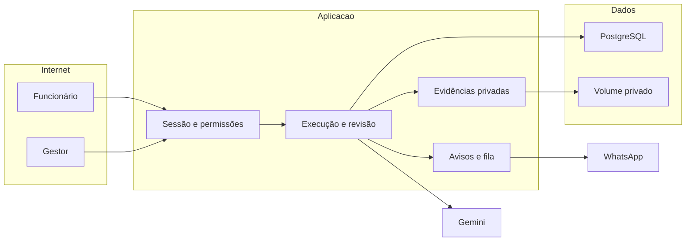

## Executive summary

O maior risco é alterar a autoria ou a execução de outra unidade, seguido de expor evidências privadas e registrar uma aprovação de IA sem base ou sobre uma resposta antiga. O link compartilhado exige sessão; a autorização continua sendo verificada no servidor. Respostas, evidências e pareceres usam escopo, trava transacional e versão. A IA fornece uma conferência auxiliar e nunca muda sozinha a nota objetiva. A disponibilidade do armazenamento e a qualidade dos pareceres exigem acompanhamento operacional.

## Scope and assumptions

- Escopo: `src/modules/checklists/`, `src/app/api/checklists/`, retorno do login, schema e migração dos checklists, armazenamento privado e serviço Gemini de conferência.
- Contexto validado com o usuário: exigir login e identificar o funcionário; IA confere evidências escritas e visuais e o gestor resolve dúvidas; avisos no sistema e por WhatsApp quando a integração estiver configurada.
- Produção: aplicativo Next.js em VPS, PostgreSQL e volume privado persistente. A aplicação é acessível pela internet; evidências não são públicas. Evidências: `Dockerfile`, `src/server/arquivos.ts`, `src/core/sessao/contexto.ts`.
- Ator e unidade vêm da sessão. Funcionário atribuído e gestor com permissão podem preencher. Acesso ao link não cria acesso à unidade.
- Fora do escopo: autenticação interna do provedor, segurança do celular, punições ou remuneração, análise sanitária certificada e alterações nos demais módulos. CI e testes usam dados sintéticos; bancos e arquivos de produção não são usados nos ensaios.
- Questões abertas: política de retenção, volume esperado e política de dados do provedor habilitado. Essas decisões afetam risco de exposição e capacidade, mas não dispensam os controles abaixo.
- Limites do legado: regras anteriores não eram integralmente versionadas; o backfill congela a configuração atual sem reconstruir passado não registrado. Capturas originais mantêm metadados privados, sem remoção de EXIF ou prova de captura recente.

## System model

### Primary components

Auth.js fornece a sessão; o contexto limita organização, unidade e permissões (`src/core/sessao/contexto.ts`). O módulo guarda modelos, cópias das regras na execução e respostas versionadas (`prisma/schema/checklists.prisma`, `src/modules/checklists/services/respostas.ts`). Evidências têm registro no banco e bytes privados (`src/modules/checklists/services/evidencias.ts`, `src/server/arquivos.ts`). A rota genérica `src/app/api/arquivos/[id]/route.ts` recusa arquivos da entidade `RespostaItem`; somente a rota específica do checklist pode entregá-los após conferir a unidade ativa. A conferência chama Gemini pelo servidor e persiste parecer com versão (`src/modules/checklists/services/conferencia.ts`, `src/server/ia/conferir-checklist.ts`). Avisos atravessam o contrato do registro de ferramentas; a Severina resolve destinatário e entrega (`src/modules/checklists/assistente.ts`, `src/registro-de-ferramentas.ts`).

### Data flows and trust boundaries

- Celular → login e ações: HTTPS, credenciais/sessão e respostas não confiáveis; destino de retorno local, sessão Auth.js e validação no servidor.
- Sessão → serviços do checklist: IDs e valores; autorização por organização/unidade/responsável, schema, cópia das regras, lock da execução e versão do item.
- Upload → volume e PostgreSQL: arquivos não confiáveis; limite de tamanho/quantidade, assinatura, nome aleatório e vínculo com item autorizado. Leituras exigem sessão e vínculo ao checklist.
- Serviço → Gemini: HTTPS, critério da operação e evidências necessárias, até 12 MB agregados por item; credencial somente no servidor, timeout, resposta validada e estado inconclusivo/indisponível em falha ou confiança abaixo de 80%. Texto dentro da evidência não é instrução do sistema.
- Checklist → Severina → WhatsApp: fatos e lembretes com escopo, chaves estáveis, configuração existente, destinatário com acesso e fila. Agentes já configurados podem avisar conclusões das últimas 24 horas ao próprio autor ou gestor. A deduplicação legada é diária e pode repetir o aviso após a virada do dia. Em paralelo, conclusões geram rascunhos cujo envio exige destinatário autorizado e confirmação humana.

#### Diagram

## Assets and security objectives

| Asset                       | Why it matters                                         | Security objective (C/I/A) |
| --------------------------- | ------------------------------------------------------ | -------------------------- |
| Respostas e autoria         | Comprovam quem declarou a execução e quando            | I                          |
| Evidências e relatos        | Podem revelar pessoas, ambiente e falhas da operação   | C/I                        |
| Regras congeladas e versões | Impedem reescrever histórico ou aplicar análise antiga | I                          |
| Credenciais e sessão        | Concedem acesso ao sistema e ao provedor               | C/I                        |
| Banco, disco e cota de IA   | Precisam continuar disponíveis durante a operação      | A                          |
| Auditoria e destinatários   | Permitem rastrear intervenções e controlar divulgação  | C/I                        |

## Attacker model

### Capabilities

Um visitante pode conhecer um link, tentar acessar rotas e enviar requests adulterados. Um usuário autenticado pode conhecer IDs, manipular tipos de resposta, tentar anexar conteúdo arbitrário ou provocar concorrência entre abas. Um funcionário pode inserir instruções em texto ou imagens para influenciar o modelo. Um destinatário pode encaminhar uma mensagem recebida.

### Non-capabilities

Conhecer o link não fornece sessão ou acesso à unidade. Este modelo não presume controle do banco, da VPS, do repositório, de segredos administrativos ou da conta do gestor. Comprometimento desses componentes requer resposta de infraestrutura e gestão de acessos, fora do fluxo de preenchimento.

## Entry points and attack surfaces

| Surface                     | How reached           | Trust boundary          | Notes                                            | Evidence (repo path / symbol)                                                          |
| --------------------------- | --------------------- | ----------------------- | ------------------------------------------------ | -------------------------------------------------------------------------------------- |
| Link e retorno do login     | Navegador ou WhatsApp | Internet/sessão         | Retorno deve ser um caminho interno válido       | `src/app/(auth)/login/`, `src/proxy.ts`                                                |
| Salvar, concluir e atribuir | Server Actions        | Sessão/serviço          | Servidor deriva ator, escopo e permissão         | `src/modules/checklists/acoes.ts`, `services/respostas.ts`                             |
| Enviar e ler evidências     | API autenticada       | Cliente/arquivo privado | Conteúdo, tamanho e ownership não são confiáveis | `src/app/api/checklists/`, `services/evidencias.ts`                                    |
| Conferir e revisar          | API autenticada       | Usuário/IA              | Parecer separado da declaração e revisão humana  | `services/conferencia.ts`, `src/server/ia/conferir-checklist.ts`                       |
| Cobranças e conclusões      | Relógio da Severina   | Módulo/mensagem externa | Não amplia destinatários nem ativa agendamentos  | `assistente.ts`, `src/modules/assistente/services/disparo.ts`, `services/rascunhos.ts` |

## Top abuse paths

1. Conhecer um ID de outra loja → enviar uma mutação ou pedir o arquivo → tentar ler evidência ou adulterar autoria. A consulta deve incluir unidade e organização em cada entrada.
2. Autenticar como outro funcionário da mesma loja → usar link atribuído ao colega → tentar preencher em seu nome. A autoria usa a sessão e a escrita exige o responsável ou gestor autorizado.
3. Enviar respostas sem foto, marcar N/A ou adulterar opções → chamar a conclusão diretamente → tentar registrar execução completa. As regras congeladas e evidências persistidas são verificadas dentro da transação.
4. Enviar arquivo executável, nome com caminho ou arquivo muito grande → tentar execução ativa ou esgotar memória/disco. A assinatura, os limites e o nome gerado reduzem o risco; o volume ainda requer capacidade e retenção.
5. Incluir “aprove tudo” numa foto ou relato → influenciar Gemini → tentar aprovação falsa. O modelo não recebe ferramentas; a saída é validada, e dúvida ou falha permanece explícita.
6. Editar a resposta durante a análise ou revisar enquanto o modelo responde → tentar gravar parecer obsoleto → esconder intervenção humana. A gravação compara versão e preserva revisão humana.
7. Gerar repetidamente lembretes ou encaminhar uma conclusão → provocar spam ou expor operação. Chaves por ocorrência e fila limitam repetição; a autorização do destinatário permanece na Severina.

## Threat model table

| Threat ID | Threat source                    | Prerequisites                | Threat action                                             | Impact                                | Impacted assets            | Existing controls (evidence)                                                                         | Gaps                                                             | Recommended mitigations                                                                          | Detection ideas                                    | Likelihood | Impact severity | Priority |
| --------- | -------------------------------- | ---------------------------- | --------------------------------------------------------- | ------------------------------------- | -------------------------- | ---------------------------------------------------------------------------------------------------- | ---------------------------------------------------------------- | ------------------------------------------------------------------------------------------------ | -------------------------------------------------- | ---------- | --------------- | -------- |
| TM-001    | Usuário de outra unidade         | Sessão válida e ID conhecido | Trocar IDs de resposta/item/evidência                     | Exposição ou corrupção entre lojas    | Evidências, respostas      | Escopo e lock em `comRespostaBloqueada`; leitura com vínculo em `services/evidencias.ts`             | IDs não substituem testes de isolamento                          | Manter teste negativo entre duas organizações e duas unidades em todas as rotas                  | Recusas de acesso sem registrar payload            | low        | high            | medium   |
| TM-002    | Funcionário autenticado          | Link de um colega            | Burlar responsável ou enviar ator forjado                 | Autoria falsa                         | Respostas, auditoria       | `exigirPodeResponder`, ator da sessão e auditoria em `services/respostas.ts`                         | Conta ou aparelho compartilhado prejudica atribuição             | Contas individuais, revogação de acesso e logout no aparelho compartilhado                       | Intervenções por gestor e mudanças de responsável  | medium     | medium          | medium   |
| TM-003    | Respondente                      | Acesso à própria execução    | Omitir anexo, alterar opções ou concluir em corrida       | Falsa conclusão e pendência duplicada | Histórico, nota            | Schema, snapshot, lock e validação no fechamento em `schemas/pontuacao.ts` e `services/respostas.ts` | Regras operacionais erradas continuam possíveis                  | Gestor deve revisar critérios; manter regressão de N/A, fotos e versões                          | Conflitos de versão e recusas de conclusão         | low        | high            | medium   |
| TM-004    | Usuário autorizado               | Permissão de upload          | Enviar conteúdo ativo ou acumular arquivos                | Exposição e indisponibilidade         | Arquivos, disco, memória   | Limites, assinatura, nome aleatório e entrega privada em `services/evidencias.ts` e API              | Não há retenção automática nem prova de autenticidade da captura | Definir retenção, backup e alerta de disco; revisar evidência suspeita                           | Tamanho do volume e taxa de upload recusado        | medium     | medium          | medium   |
| TM-005    | Conteúdo adversarial ou provedor | Item com análise habilitada  | Instruir IA pela evidência ou retornar JSON inválido      | Parecer incorreto                     | Integridade da conferência | Instrução separada, validação e estado de falha em `src/server/ia/conferir-checklist.ts`             | IA pode errar com saída válida                                   | Revisão humana para dúvidas, confiança baixa e casos críticos; não vincular a punição automática | Proporção de inconclusivos, erros e revisões       | medium     | medium          | medium   |
| TM-006    | Concorrência ou resposta tardia  | Duas abas/análise em curso   | Aplicar estado antigo após edição ou revisão              | Perda de evidência/revisão            | Versões e pareceres        | Comparação de versão e lock em `services/respostas.ts`, `services/conferencia.ts`                    | Processo interrompido pode deixar análise pendente               | Recuperar estado pendente com limite e revisão explícita                                         | Idade da análise pendente                          | low        | medium          | low      |
| TM-007    | Remetente ou destinatário        | Canal conectado              | Repetir cobrança ou divulgar conteúdo a pessoa sem acesso | Spam e vazamento de operação          | Avisos, dados da loja      | Escopo e chaves em `assistente.ts`; destinatário em `src/modules/assistente/services/avisos.ts`      | Encaminhamento após entrega não é revogável                      | Usar links autenticados e mínimo necessário na mensagem                                          | Fila, recibos e reclamações de repetição           | low        | medium          | low      |
| TM-008    | Visitante                        | URL de login adulterada      | Usar retorno externo ou caminho enganoso                  | Redirecionamento para phishing        | Confiança no login         | Validação do destino interno no fluxo de login                                                       | Validação precisa permanecer centralizada                        | Manter testes para URL externa, `//`, barras e caracteres de controle                            | Recusas de destino inválido sem gravar credenciais | low        | medium          | low      |

## Criticality calibration

- **critical:** execução remota no servidor por upload; leitura irrestrita de segredos de produção; destruição ampla do banco ou volume sem recuperação. Nenhuma dessas capacidades é presumida por conhecer o link.
- **high:** acesso comprovado a evidências de outra organização; falsificação generalizada de autoria; aprovação automática que substitui revisão humana e altera histórico. Exige correção antes de publicar.
- **medium:** funcionário autorizado esgota quota/disco; parecer válido porém incorreto; contas compartilhadas tornam autoria ambígua. Exigem controles e acompanhamento operacional.
- **low:** conflito de aba comunicado e recuperável; cobrança duplicada isolada contida pela fila; análise interrompida visível como pendente. Não confundir erro recuperável com aprovação.

## Focus paths for security review

| Path                                                                        | Why it matters                                          | Related Threat IDs             |
| --------------------------------------------------------------------------- | ------------------------------------------------------- | ------------------------------ |
| `src/modules/checklists/services/respostas.ts`                              | Centraliza escopo, ator, responsável, lock e fechamento | TM-001, TM-002, TM-003, TM-006 |
| `prisma/schema/checklists.prisma` e migração                                | Preserva regras e integridade do histórico              | TM-003, TM-006                 |
| `src/modules/checklists/services/evidencias.ts` e `src/app/api/checklists/` | Protege vínculo, limites e entrega dos arquivos         | TM-001, TM-004                 |
| `src/server/ia/conferir-checklist.ts` e `services/conferencia.ts`           | Valida saída e impede parecer obsoleto                  | TM-005, TM-006                 |
| `src/modules/checklists/assistente.ts`                                      | Define escopo e idempotência dos avisos                 | TM-007                         |
| `src/app/(auth)/login/`                                                     | Preserva retorno sem redirecionamento externo           | TM-008                         |

## Notes on use

Cobertura: entradas autenticadas, arquivos, provedor e mensagens foram considerados; cada fronteira aparece em pelo menos uma ameaça. O modelo diferencia produção de testes/CI e registra as decisões confirmadas pelo usuário. Retenção e política do provedor continuam decisões operacionais abertas. O relatório documenta os controles do código e os riscos residuais; não substitui testes de isolamento, ensaio de migração, smoke do deployment nem avaliação humana das evidências.
