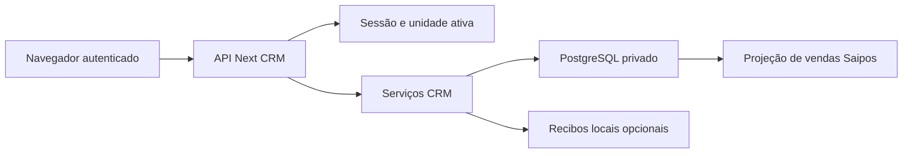

# Modelo de ameaças — CRM integrado

## Escopo e contexto confirmado

Sistema da Vitaliano Pizzaria, público via HTTPS na VPS com Dokploy, login
existente e dados pessoais de clientes separados por unidade. A publicação da
integração foi autorizada pelo responsável no chat. Permanecem fora do escopo
provedores de envio real, mudanças no login e migração dos dados locais antigos.

## Componentes e limites

- Navegador/API: HTTPS de produção, sessão Auth.js, checagem de origem nas
  escritas, JSON limitado a 1 MB, filtros estritos e limite por usuário.
  Evidências: `src/app/api/crm/[...caminho]/route.ts`, `services/request.ts`.
- Sessão/unidade: `obterContexto` e `crmUser` usam a unidade ativa e as permissões
  do Core. IDs de corpo ou query nunca ampliam esse escopo.
  Evidências: `src/core/sessao/contexto.ts`, `src/modules/crm/services/scope.ts`.
- Serviços/banco: chaves estrangeiras compostas recusam contato, venda,
  campanha ou visita de outra unidade. A organização deriva da unidade
  autorizada. Não se pressupõe RLS nas tabelas novas.
  Evidência: `prisma/schema/crm.prisma` e a migração CRM.
- Saipos/CRM: somente venda explicitamente vinculada gera projeção; atualização
  de cancelamentos não escreve na tabela de origem.
  Evidências: `services/service.ts::linkSale`, `services/saipos-links.ts`.

## Ativos e ameaças priorizadas

| Ameaça                                                                          | Probabilidade / impacto | Controle implementado e risco restante                                                                                                                                                      |
| ------------------------------------------------------------------------------- | ----------------------- | ------------------------------------------------------------------------------------------------------------------------------------------------------------------------------------------- |
| Ler ou alterar clientes de outra unidade/organização por IDs forjados           | Média / alto            | Sessão e unidade ativa obrigatórias, filtros no servidor e FKs compostas. Teste de API e rejeição no PostgreSQL em `crm.integracao.ts`.                                                     |
| Forjar alterações usando a sessão da vítima                                     | Média / alto            | Origem exata, bloqueio de `cross-site`, conteúdo JSON, cookies da sessão existente. Testes em `request.test.ts`. XSS no mesmo domínio continua dependendo das defesas gerais do aplicativo. |
| Importação repetida, concorrência ou revisão antiga corromper visitas/campanhas | Média / alto            | Hash de payload, chave idempotente, transações, lock por unidade e versão na aprovação. Testes de repetição, revisão e prévia obsoleta.                                                     |
| Capturar identidade ou enviar campanha sem autorização                          | Média / alto            | HMAC por unidade, cifra autenticada, segredo somente no servidor, consentimento comprovado e revisão antes da entrega. Nenhum transporte real é integrado.                                  |
| Arquivo grande ou consultas em massa esgotarem recursos                         | Média / médio           | Corpo de 1 MB, 500 linhas por lote, paginação e limite de solicitações. Consultas agregadas podem exigir índices adicionais conforme a base crescer.                                        |
| Publicação sobrescrever módulos já em produção                                  | Média / alto            | Base `origin/main`, worktree separado, migração aditiva e push sem força; compilação e revisão antes do deploy. Sem promessa de backup operacional não verificado.                          |

## Pressupostos e operação

Os administradores da VPS, GitHub e banco são confiáveis. Um usuário comum não
tem acesso direto ao banco nem à chave de identidade. A revisão não altera
permissões de usuários existentes. Backups e restauração da VPS são controles
operacionais externos a esta mudança. A chave deve permanecer estável; a
derivação de `AUTH_SECRET` e sua rotação estão documentadas em `unificacao-crm.md`.

Os testes usam somente registros fictícios em PostgreSQL local. Nenhum dado ou
segredo de produção é usado nesses testes. Após publicar, a confirmação visual
no domínio é de leitura; os formulários são exercitados no ambiente local.
