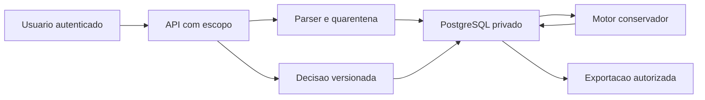

## Executive summary

O módulo importa extratos privados e oferece uma decisão financeira auditável,
sem dar baixa ou escrever em fornecedores. Os riscos centrais são vazamento entre
lojas, confirmação falsa por duplicação/alocação e perda de decisão humana.
Escopo de sessão, FKs compostas, leitura conservadora e histórico imutável tratam
essas fronteiras. Evidências: `services/conferencia.ts`, `schemas/conferencia.ts`
e migrations `20261025160000`/`20261025160100`.

## Scope and assumptions

- Escopo: `src/app/api/finance`, rota de conferência, schemas/services/components
  do Financeiro e `prisma/schema/conferencia.prisma`.
- Contexto confirmado pelo usuário: VPS existente; acesso por permissões atuais
  ver/lancar/quitar; originais privados por organização/loja; modo de observação.
- Produção observada: Next.js/Auth.js por HTTPS, Dokploy, PostgreSQL privado.
- Fora do escopo: alterar autenticação, pagamentos, Saipos, RLS global ou conceder
  permissões. Não há integração bancária externa neste incremento.
- Cobertura é declaração de arquivo, não garantia de completude do provedor.
  Retenção/limite total de armazenamento ainda dependem da política operacional.

## System model

### Primary components

Navegador autenticado → route handler → serviços autorizados → PostgreSQL.
O parser normaliza linhas sem executar conteúdo. O motor compara snapshots e
registra lotes/alocações. O Docker aplica migrations antes da nova aplicação.
Âncoras: `api/finance/[...caminho]/route.ts`, `server/db.ts`, `docker-entrypoint.sh`.

### Data flows and trust boundaries

- Internet → Auth.js → contexto: cookie de sessão HTTPS, organização/unidade e
  permissões lidas do servidor; `core/sessao/contexto.ts`.
- Navegador → API: CSV/JSON/PDF/imagens via JSON limitado; sessão, origem, Zod,
  conta, tamanho e rate limit; route handler e `limitarConferencia`.
- Conteúdo externo → parser → banco: UTF-8, centavos, fuso, validação por fonte,
  quarentena; `schemas/importacao-conferencia.ts`.
- Serviços → banco: consultas com escopo, FKs compostas, trava por loja,
  unicidade, versões otimistas e triggers; schema/migrations.
- Banco → download: autorização repetida, attachment/no-store/nosniff/sandbox;
  exportação CSV com neutralização de fórmulas.
- Desenvolvedor → Git/Dokploy: código sem segredos, backup privado e ensaio em
  banco descartável; separado do runtime e das fixtures fictícias.

#### Diagram

## Assets and security objectives

| Ativo                         | Por que importa                              | Objetivo |
| ----------------------------- | -------------------------------------------- | -------- |
| Extratos/originais/evidências | Informações financeiras privadas             | C/I      |
| Limite organização/loja       | Evitar vazamento e decisão na unidade errada | C/I      |
| Contratos e cálculos          | Evitar afirmar recebimento/taxa falsa        | I        |
| Decisões e auditoria          | Responsabilidade e histórico verificável     | I        |
| Banco e disponibilidade       | Continuidade da operação existente           | I/A      |

## Attacker model

### Capabilities

Visitante tenta acessar rotas sem sessão. Usuário autenticado manipula IDs,
arquivos, valores, origem e requisições concorrentes dentro de suas permissões.
Um arquivo pode ser grande, parcial, duplicado ou conter fórmulas/HTML.

### Non-capabilities

Usuário comum não controla o servidor, a chave de sessão ou o banco. Não existe
endpoint para executar código de arquivo, buscar URL externa ou transferir
dinheiro. Quem administra diretamente o PostgreSQL permanece fora desse limite.

## Entry points and attack surfaces

| Superfície           | Acesso           | Fronteira       | Controle                               | Evidência                                      |
| -------------------- | ---------------- | --------------- | -------------------------------------- | ---------------------------------------------- |
| Prévia/confirmação   | POST autenticado | arquivo/API     | limite, origem, parser, idempotência   | route.ts; previaImportacao/confirmarImportacao |
| Execução             | POST autenticado | API/motor/banco | trava, snapshot, regras fixadas        | executarConferencia                            |
| Revisão/contratos    | POST autorizado  | pessoa/decisão  | permissão, versão, motivo, append-only | registrarDecisao/criarContrato                 |
| Originais/evidências | GET autenticado  | banco/navegador | filtro composto, download privado      | originalImportacao/lerEvidencia                |
| Exportação           | GET autenticado  | banco/planilha  | escopo e CSV seguro                    | exportarConferencia/csvSeguro                  |
| Deploy               | SSH/Git/Dokploy  | código/produção | backup, migrations aditivas            | Dockerfile; migrations                         |

## Top abuse paths

1. Trocar ID de importação/caso → tentar obter extrato de outra loja → filtro
   composto não encontra o registro; FKs também impedem vínculo cruzado.
2. Reenviar arquivo ou sobrepor linhas sem ID → inflar totais → SHA-256,
   identidade estável e revisão explícita conservam a multiplicidade correta.
3. Reaproveitar depósito em várias vendas → falso fechamento → lote único,
   componentes e trigger de limite impedem exceder o crédito por execução.
4. Revisões concorrentes → perder a decisão anterior → versão otimista aceita
   somente uma; histórico e bytes são imutáveis no PostgreSQL.
5. Fórmula/HTML em nome ou observação → execução ao baixar/abrir → React escapa,
   download attachment e CSV neutralizado; arquivos não são executados.
6. Muitos uploads/runs → memória/banco indisponíveis → teto de bytes/linhas,
   rate limit compartilhado e transações com timeout; retenção total é residual.

## Threat model table

| Threat ID | Threat source       | Prerequisites        | Threat action                           | Impact                         | Impacted assets | Existing controls (evidence)                 | Gaps                                      | Recommended mitigations                            | Detection ideas                                 | Likelihood | Impact severity | Priority |
| --------- | ------------------- | -------------------- | --------------------------------------- | ------------------------------ | --------------- | -------------------------------------------- | ----------------------------------------- | -------------------------------------------------- | ----------------------------------------------- | ---------- | --------------- | -------- |
| TM-001    | Usuário autenticado | Sessão de outra loja | Forjar ID/conta                         | Vazamento cruzado              | Extrato/escopo  | escopoConferencia e FKs compostas            | Sem RLS global comprovada                 | Preservar testes negativos em novas rotas          | 403/404 e revisão de queries                    | baixa      | alto            | medium   |
| TM-002    | Operador/arquivo    | Importar permitido   | Duplicar fontes                         | Total falso                    | Cálculos        | hash, identidade ativa e revisão sem ID      | Fornecedor pode omitir dados              | Conferir cobertura com origem                      | Relatório de parsing e conflitos                | média      | alto            | medium   |
| TM-003    | Concorrência/bug    | Várias fontes/lotes  | Exceder crédito ou sobrescrever decisão | Confirmação falsa              | Lotes/decisões  | trigger, lock por loja, expectedVersion      | Administrador SQL mantém poderes          | Ensaiar constraints e conflito a cada evolução     | Eventos de execução/decisão                     | baixa      | alto            | medium   |
| TM-004    | Arquivo hostil      | Leitura autorizada   | Fórmula/HTML                            | Comprometer navegador/planilha | Sessão/dados    | csvSeguro, React, attachment/nosniff/sandbox | Leitor externo de PDF tem riscos próprios | Manter downloads sem execução inline               | Testes de CSV e tamanho                         | baixa      | médio           | low      |
| TM-005    | Usuário autorizado  | Acesso a upload/job  | Exaurir recursos                        | Parada                         | Banco/serviço   | 2 MB, 5000 linhas, rate limit e timeout      | Sem quota total/retencão definida         | Definir retenção e quota conforme volume real      | Quantidade de imports, bytes, erros sanitizados | média      | médio           | medium   |
| TM-006    | Operação            | Atualizar produção   | Migration incompatível                  | Indisponibilidade              | Banco/histórico | migrations aditivas, ensaio clone e vazio    | Requer preservar backup privado           | Guardar backup e verificar restore antes do deploy | Estado Dokploy/migrations e HTTP                | baixa      | alto            | medium   |

## Criticality calibration

- critical: visitante lê extratos de toda rede; execução remota no servidor.
  Nenhum caminho assim foi introduzido.
- high: acesso cruzado a extrato real; confirmação falsa com alteração de caixa.
  Escopo e modo de observação reduzem esses caminhos.
- medium: arquivo incompleto induz interpretação; abuso de recursos por usuário
  autorizado; conflito exige nova decisão.
- low: layout não suportado recusado; PDF só para download; erro sanitizado sem
  alteração de registros.

## Focus paths for security review

| Path                                                             | Why it matters                                | Related Threat IDs |
| ---------------------------------------------------------------- | --------------------------------------------- | ------------------ |
| src/app/api/finance/[...caminho]/route.ts                        | Sessão, origem, tamanho, downloads            | TM-001/004/005     |
| src/modules/financeiro/services/conferencia.ts                   | Escopo, transação, versão, auditoria          | TM-001/002/003     |
| src/modules/financeiro/schemas/importacao-conferencia.ts         | Interpretação de arquivo não confiável        | TM-002/005         |
| src/modules/financeiro/schemas/conferencia.ts                    | Confirmação conservadora e CSV                | TM-002/003/004     |
| prisma/schema/migrations/20261025160000_conferencia_recebimentos | FKs, imutabilidade e alocação                 | TM-001/003/006     |
| scripts/conferencia-ensaio.ts                                    | Banco descartável e validação de persistência | TM-002/003/006     |

## Notes on use

Contexto e permissões confirmados antes deste relatório. Leitura, escrita,
arquivos, revisão, exportação e deploy estão cobertos; runtime separado de
build/ensaio. Originais não são exemplos e exemplos não são resultados de
produção. A validação e o estado de publicação ficam em `financeiro-conferencia.md`
e no registro final de entrega; este documento não afirma homologação de banco.
