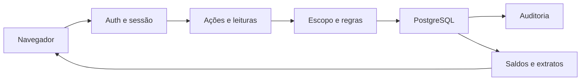

# Financeiro bancário — modelo de ameaças

## Executive summary

Os principais riscos são alterar dinheiro sem autorização, misturar organizações
ou CNPJs e duplicar movimentos ao repetir uma solicitação. A fase 2 valida esses
limites no servidor e usa vínculos compostos, centavos inteiros, transações e
gatilhos no PostgreSQL. A revisão também corrigiu a soma indevida de permissões
de organizações diferentes na sessão. Não há execução de pagamentos externos.

## Scope and assumptions

- Escopo: novas páginas e ações bancárias, serviços Financeiro, schema/migração e
  seleção dos acessos da sessão.
- Implantação: Next.js/Auth.js na base de produção, publicada pelo Dokploy na
  branch main, conforme `AGENTS.md` e `Dockerfile`.
- O usuário confirmou que quem possui acesso ao Financeiro pode ver contas PF
  usadas pela loja. CNPJs distintos compartilham uma unidade física.
- Quem lança e quem confirma dinheiro mantêm permissões distintas. Transferir
  exige as duas permissões existentes, sem conceder papéis novos.
- Saipos, certificados, senhas de banco, execução de PIX/boletos, conciliação e
  importações ficam fora desta fase. Testes usam exclusivamente PostgreSQL local
  descartável, com dados fictícios.

Não restam perguntas de contexto para esta fase. HTTPS, controle do host e
restrição das credenciais de banco são premissas operacionais da implantação.
Não foi afirmada a existência de RLS: os vínculos compostos protegem referências;
as leituras dependem do escopo validado no servidor.

## System model

### Primary components

Auth.js autentica a sessão; o Core escolhe organização/unidade e permissões.
As páginas bancárias fazem leituras autorizadas e os formulários chamam Server
Actions. `services/bancos.ts` valida o domínio e grava banco e auditoria na
mesma transação. `Lancamento` continua sendo a fonte das baixas existentes.

### Data flows and trust boundaries

- Navegador → Next.js: IDs, datas, centavos representados por texto e metadados
  bancários; HTTPS operacional, sessão Auth.js e proteção de origem das Server
  Actions. Cada ação obtém novamente o contexto.
- Core → Financeiro: usuário, organização, unidade visível e permissões;
  `acessosNaOrganizacao` impede herdar papéis de outra organização.
- Financeiro → PostgreSQL: consultas Prisma parametrizadas e transações;
  `escopo` revalida unidade ativa e organização. Zod e regras puras validam
  valores, documentos e datas. Vínculos compostos impedem pernas entre CNPJs.
- PostgreSQL → navegador: saldo/extrato apenas da unidade autorizada; a página
  de contas mostra a empresa selecionada. Os ícones são arquivos locais, sem
  envio de dados bancários a serviços de imagem.

#### Diagram

## Assets and security objectives

| Ativo                              | Por que importa                               | Objetivo |
| ---------------------------------- | --------------------------------------------- | -------- |
| Aberturas, baixas e transferências | Determinam disponibilidade de caixa           | I, A     |
| Empresa, titular e conta bancária  | Dados pessoais/empresariais e destino correto | C, I     |
| Sessão e permissões                | Determinam quem pode ler e movimentar         | C, I     |
| Histórico e auditoria              | Permitem reconstruir e atribuir correções     | I, A     |

## Attacker model

### Capabilities

Uma pessoa autenticada pode adulterar FormData, tentar IDs de outra unidade,
repetir pedidos e enviar solicitações concorrentes. Um navegador sem sessão
pode tentar acessar URLs e ações diretamente.

### Non-capabilities

O modelo não concede ao atacante acesso administrativo ao PostgreSQL, ao host,
à assinatura da sessão ou ao repositório. Quem já controla esses recursos
ultrapassa os limites de autorização da aplicação. Um cadastro bancário não
autoriza movimentar dinheiro real no banco externo.

## Entry points and attack surfaces

| Superfície              | Acesso                       | Limite                   | Evidência                                       |
| ----------------------- | ---------------------------- | ------------------------ | ----------------------------------------------- |
| Contas e extrato        | Páginas autenticadas         | sessão → leitura         | `src/app/(shell)/financeiro/contas/`            |
| Empresas e contas       | Server Actions               | formulário → gravação    | `src/modules/financeiro/acoes-bancos.ts`        |
| Transferência e estorno | Server Actions               | permissão → dinheiro     | `services/bancos.ts: gravarTransferencia`       |
| Baixa existente         | Server Action                | unidade → conta bancária | `services/lancamentos.ts: quitarLancamento`     |
| Sessão de tela/fundo    | Auth.js e consultas internas | acesso → papel           | `src/core/sessao/contexto.ts`, `nucleo.ts`      |
| Migração                | Operador/contêiner           | implantação → banco      | `20261026045345_contas_bancarias/migration.sql` |

Os caminhos de serviços referem-se a `src/modules/financeiro/`.

## Top abuse paths

1. Usar papel de administrador em outra organização → montar sessão combinada →
   alterar dados da primeira. A filtragem de acessos foi corrigida e testada.
2. Trocar o ID do destino → apontar para outro CNPJ/unidade → misturar caixa.
   A validação pura e as chaves compostas recusam a operação.
3. Repetir um formulário após lentidão → criar duas transferências → distorcer
   ambos os saldos. Chave única e assinatura do conteúdo devolvem o mesmo registro.
4. Editar abertura depois de movimentar → reescrever saldo histórico. Controle
   de versão e gatilhos recusam a alteração; estorno não apaga o original.
5. Usar permissão de cadastro para confirmar dinheiro → registrar movimentação
   sem permissão de baixa. A operação exige também `financeiro.quitar`.
6. Pedir extrato de período enorme → consumir recursos ou receber saldo truncado.
   O período é limitado e excesso de movimentos pede filtro menor.

## Threat model table

| ID     | Origem                   | Pré-requisito                        | Ação                                     | Impacto                           | Ativo                | Controles existentes                                                          | Lacuna                                                     | Mitigação recomendada                                            | Detecção                                         | Probabilidade               | Impacto | Prioridade |
| ------ | ------------------------ | ------------------------------------ | ---------------------------------------- | --------------------------------- | -------------------- | ----------------------------------------------------------------------------- | ---------------------------------------------------------- | ---------------------------------------------------------------- | ------------------------------------------------ | --------------------------- | ------- | ---------- |
| TM-001 | Usuário multiorganização | Papéis distintos em redes diferentes | Herdar papel de outra rede               | Alteração/leitura indevida        | Sessão e dinheiro    | `acessosNaOrganizacao`, teste puro e integração da sessão                     | Seleção da organização segue a sessão existente            | Preservar o filtro em mudanças futuras do Core                   | Regressão de duas organizações                   | Baixa após correção         | Alto    | medium     |
| TM-002 | Usuário autenticado      | Manipular IDs do formulário          | Cruzar unidade ou CNPJ                   | Caixa atribuído à empresa errada  | Saldos               | `escopo`, `validarParTransferencia`, FKs compostas                            | Leituras não têm RLS                                       | Manter escopo nas novas consultas; não tratar FK como RLS        | Regressão de leitura e tentativa direta no banco | Baixa                       | Alto    | medium     |
| TM-003 | Retry ou concorrência    | Mesmo pedido enviado várias vezes    | Duplicar transferência/estorno           | Saldo incorreto                   | Dinheiro e histórico | Serialização, chave única, assinatura por autor/unidade, estorno único        | Limite de tentativas pode devolver erro sob alta contenção | Pedir retry preservando a chave                                  | Auditoria e testes concorrentes                  | Baixa                       | Alto    | low        |
| TM-004 | Operador com cadastro    | Conta já movimentada                 | Alterar abertura ou apagar transferência | Histórico reescrito               | Histórico e saldo    | Versão/assinatura, gatilhos de imutabilidade e auditoria transacional         | Usuário autorizado ainda pode declarar uma operação falsa  | Conferir extrato e revisar auditoria por processo interno        | Original e estorno rastreáveis                   | Média para erro operacional | Alto    | medium     |
| TM-005 | Cadastro sem baixa       | Possuir apenas financeiro.lancar     | Transferir/estornar                      | Confirmação de dinheiro sem poder | Caixa                | Ambas as permissões em `gravarTransferencia`                                  | Cadastro de abertura continua com quem cadastra bancos     | Rever concessões de papéis quando a equipe mudar                 | Teste sem financeiro.quitar                      | Baixa                       | Alto    | low        |
| TM-006 | Leitor autenticado       | Acesso legítimo e muitas consultas   | Exigir extratos extensos                 | Lentidão                          | Disponibilidade      | 366 dias, 1.000 movimentos, consultas por unidade e índices de transferências | Não há limite específico por usuário nesta fase            | Medir volume antes de ampliar históricos ou adicionar exportação | Latência e erros de período extenso              | Baixa no volume informado   | Médio   | low        |

## Criticality calibration

- **critical**: bypass anônimo com alcance em todas as organizações; controle do
  host que exponha todas as credenciais. Nenhum dos dois foi identificado.
- **high**: leitura entre organizações; alteração silenciosa de saldos em outro
  CNPJ. O caminho de herança de papéis foi corrigido antes da publicação.
- **medium**: operação falsa por alguém já autorizado; regressão de isolamento
  ou reescrita de abertura. Exigem controles e revisão continuados.
- **low**: retry recusado sob contenção; período extenso recusado; ícone ausente
  com iniciais como alternativa. Não devem alterar dinheiro.

## Focus paths for security review

| Caminho                                                     | Motivo                                  | Ameaças         |
| ----------------------------------------------------------- | --------------------------------------- | --------------- |
| `src/core/sessao/escopo-acessos.ts`                         | Papel e unidade pertencem à organização | TM-001          |
| `src/modules/financeiro/services/bancos.ts`                 | Escopo, atomicidade e idempotência      | TM-002 a TM-005 |
| `src/modules/financeiro/schemas/bancos.ts`                  | Centavos, data e CNPJ                   | TM-002, TM-004  |
| `prisma/schema/migrations/20261026045345_contas_bancarias/` | Integridade fora da aplicação           | TM-002 a TM-004 |
| `src/modules/financeiro/services/bancos.integracao.ts`      | Concorrência, migração e escopo         | TM-001 a TM-006 |
