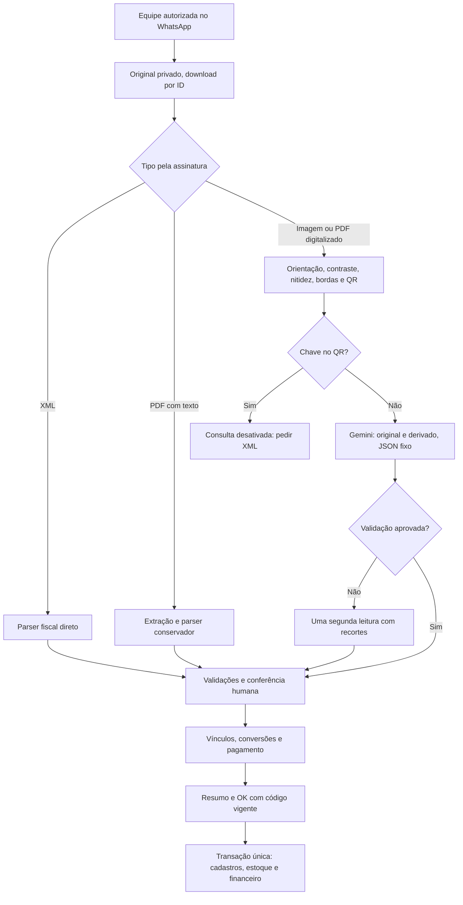

# Leitura fiscal v2

Decisões do responsável: consulta externa desativada; Gemini atual e Free Tier;
segunda tentativa com recortes; confirmação antes de estoque e financeiro.
Fixtures disponíveis são sintéticas. **Acurácia em notas reais não medida.**

## Fluxo e implementação



| Etapa                                                                        | Arquivos                                                                                                                                          |
| ---------------------------------------------------------------------------- | ------------------------------------------------------------------------------------------------------------------------------------------------- |
| Entrada e original de até 20 MB                                              | `connectors/whatsapp/webhook-evolution.ts`, `nota-midia.ts`                                                                                       |
| Seleção do método                                                            | `server/notas/pipeline.ts`                                                                                                                        |
| XML sem entidades externas                                                   | `server/notas/xml.ts`                                                                                                                             |
| PDF em processo separado                                                     | `server/notas/pdf.ts`, `scripts/pdf-fiscal-worker.cjs`                                                                                            |
| EXIF, cinza, contraste, nitidez, bordas e inclinação até 7°                  | `server/notas/imagem.ts`                                                                                                                          |
| QR em thread terminável; sem navegação na URL                                | `server/notas/qr.ts`                                                                                                                              |
| Interface substituível, desativada por padrão                                | `server/notas/consulta.ts`                                                                                                                        |
| Prompt `PROMPT_FISCAL`, temperatura 0, JSON Schema fixo nullable e confiança | `server/notas/gemini.ts`                                                                                                                          |
| Reserva por tentativa, orçamento compartilhado, mesmo modelo                 | `server/notas/orcamento.ts`                                                                                                                       |
| Dígitos, totais e rateio de centavos                                         | `lib/documento-fiscal.ts`, `server/notas/extracao.ts`, `nota-assistida-contrato.ts`                                                               |
| Casamento e conversa                                                         | `server/notas/casamento.ts`, `modules/assistente/schemas/leitura-fiscal.ts`, `conferencia-nota.ts`, `app/api/whatsapp/_costura/notas-conversa.ts` |
| Transação serializável, autorização e idempotência                           | `app/api/whatsapp/_costura/lancar-nota.ts`                                                                                                        |

O conector conserva os bytes fornecidos pela Evolution. Enviar a foto **como
documento** evita a compressão do WhatsApp. Não é possível recuperar a resolução
de uma foto já comprimida. A aplicação não usa resize para caber nos limites;
pede XML ou outro documento. Original, derivados e recortes permanecem privados.

## Validações e confirmação

CPF/CNPJ e chave têm dígitos verificados; chave precisa concordar com emitente,
número, série e mês. Duplicidade por chave ou fornecedor/número/série é conferida
novamente na transação. Quantidade × preço precisa explicar cada linha; brutos
menos descontos mais acréscimos precisam explicar o total. Parcelas somam o total
e exigem datas válidas. A tolerância é de um centavo, configurável de zero a cinco
por `NOTAS_TOLERANCIA_CENTAVOS`. O rateio por maiores restos conserva os centavos e
a transcrição original; eventual arredondamento permitido fica no rascunho.

Campos ilegíveis permanecem `null`. Confiança abaixo de 0,9 e alertas impedem
proposta pronta até conferência. `CONFERI LEITURA` confirma campos presentes e
alertas; não completa ausências nem resolve inconsistências. `SEM AJUSTES`
confirma descontos e acréscimos zero quando não estavam legíveis. Correções
invalidam o código anterior. `ITENS` exibe descrições, valores e conversões;
`OK CODIGO` ou `CONFIRMAR CODIGO` autoriza a versão entregue por até 30 minutos e
declara que as mercadorias foram recebidas. `OK` sozinho nunca lança.

Fornecedor é encontrado pelo documento. Novos fornecedores/insumos ficam como
propostas e são criados no commit confirmado. Itens usam código confirmado do
fornecedor, depois EAN. Sem identificador impresso, descrição exata já confirmada
para o mesmo fornecedor e unidade pode reutilizar o vínculo e a conversão;
conflitos impedem a escolha. Similaridade gera sugestões para escolha humana.
Contradições, unidades diferentes e embalagem com conversão alterada exigem nova
conferência. Vínculos são aprendidos apenas após lançamento concluído.

A segunda leitura usa recortes sobrepostos de cabeçalho, itens e totais no mesmo
modelo. Divergências entre leituras ficam pendentes. Cota, rede e credencial não
repetem geração. A falha da segunda leitura conserva a primeira parcial para
conferência. Reservas impedem repetir gerações em replay, inclusive com custo zero.

## Provedor externo pendente

Nenhum provedor foi escolhido. QR decodificado pede o XML, sem disparar OCR ou
consultar a URL impressa. O futuro conector implementará `ConsultaFiscal` e será
injetado pela camada `app`, após decisão sobre provedor, autenticação e custos.
O XML retornado precisará ter a chave solicitada. Não existe variável de ambiente
que ative consulta genérica nesta entrega. Assinatura digital e situação atual na
SEFAZ não são verificadas; esse limite aparece na conferência do XML.

## Testar e comparar

```powershell
npm run check
npm run build
npm run fixtures:notas
npm run avaliar:notas -- --saida caminho-privado/atual.json
npm run avaliar:notas -- --baseline caminho-privado/antes.json --saida caminho-privado/depois.json
```

O avaliador padrão não usa banco nem rede. Fotos sem Gemini aparecem sem leitura;
ausências não aumentam acertos. Resultados incluem taxa por campo, valores
ausentes/indevidos, quantidade de linhas, duração e tokens, separados por
proveniência. Relatórios contêm dados fiscais: guardar fora do Git.
`--predicoes arquivo.json` aceita um mapa de nome de fixture para extração
canônica anterior, usando o mesmo gabarito. `--baseline` compara taxas por campo.

Para avaliação visual opcional, usar `--gemini-free` e definir **no ambiente
privado** `NOTAS_AVALIACAO_GEMINI_KEY` e `NOTAS_AVALIACAO_FREE_TIER=confirmado`.
O script usa `gemini-2.5-flash`, até duas leituras por fixture e tarifas zero;
consome a cota gratuita da chave. Não busca a chave do painel, não troca para
modelo pago e não cadastra notas. Testes automatizados do Gemini usam mocks.

`npm run test:integracao` exige `DATABASE_URL_TESTE` local com nome `_test`.
O histórico antigo falha ao migrar banco vazio em `20260911120000_compras_fluxo`;
isso não foi alterado aqui. Nesta tarefa, um banco descartável UTF-8 recebeu SQL
da estrutura anterior (`prisma migrate diff --from-empty --to-schema ... --script`)
e a nova migração aditiva. Nenhum teste usa banco de produção.
As restrições e a política RLS históricas de recebimentos do PDV também foram
reproduzidas nesse banco, pois `migrate diff` não inclui SQL personalizado.

Validação desta entrega: `npm run check` aprovado com **849 testes unitários**;
`npm run build` aprovado. **80 verificações de integração** passaram, em dois
lotes: 39 para lançamento/conversa/fila/orçamento e 41 para autorização, leitor
legado e integridade operacional. Os nove casos sintéticos foram avaliados sem
API; uma segunda execução com baseline reproduziu as taxas, com zero tokens.
Gemini foi simulado nos testes. Não houve nota real, envio real de WhatsApp ou
lançamento de teste em produção. Permanecem cinco avisos de lint no CRM e três
avisos de tracing do arquivo `server/arquivos.ts`, anteriores a esta mudança.

## Commits da implementação

| Commit    | Mudança                                                                                                    |
| --------- | ---------------------------------------------------------------------------------------------------------- |
| `322d7f1` | Remove dependência de tempo no teste da trava do assistente privado, usando o sinal de início da operação. |
| `81e74ca` | Introduz extração canônica, validação de dígitos/totais e casamento fiscal.                                |
| `18bd908` | Adiciona XML/PDF/QR, preparação de imagens, schema Gemini, fixtures e avaliador.                           |
| `d56d393` | Persiste evidências privadas, contagem de tentativas e reserva para até duas leituras.                     |
| `eccc743` | Integra a leitura ao WhatsApp, correções, resumo com código e contrato de lançamento preservado.           |

A documentação de operação e o modelo de ameaças são entregues em um commit
separado. Os commits foram preparados na branch `codex/notas-fiscais-leitura`
para publicação em `main`, destino confirmado na configuração do Dokploy.

## Limites e auditoria

Uma nota por arquivo, até 100 itens, arquivo de 20 MB e imagem de 20 megapixels.
PDF: até cinco páginas, 240 mil caracteres, renderização a 3× com geometria
verificada antes do canvas, máximo de 20 megapixels por página. Processo sem
credenciais herdadas, prazo de 25 segundos e heap de 256 MB; isso não representa
sandbox de sistema operacional nem teto absoluto de memória nativa. QR: thread
de oito segundos. Gemini: 16 MB agregados, até 15 imagens, contagem limitada a
32.768 tokens e 16.384 tokens de saída. Lease de quatro minutos na fila.

Auditoria registra IDs dos arquivos, método, versão, tentativas, tokens,
validações e códigos de rejeição. Erros não expõem segredos ou corpo do provedor.
Original e correções ficam separados. XML é entregue como anexo na rota
autenticada, com CSP restritiva. Layout desconhecido permanece pendente.

Pendências do responsável: escolher provedor depois e fornecer notas reais
anonimizadas com gabarito revisado para avaliar acurácia visual antes/depois.
