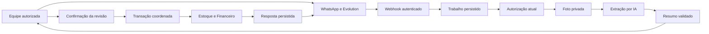

# Modelo de ameaças — notas pelo WhatsApp

## Executive summary

Foto de nota ou cupom é entrada não confiável. O risco principal é transformar uma
imagem, mensagem repetida ou confirmação de outro contexto em estoque ou dívida.
O fluxo é interno: o servidor identifica a pessoa e a unidade, extrai uma proposta,
exibe o resumo e só executa efeitos após confirmação explícita da versão vigente.
O agente de atendimento ao cliente não ganha ferramentas financeiras. A implementação
usa fila durável com leases, resumo versionado, confirmação por código e transação
única para estoque e financeiro. Entrega incerta de mensagem é consultada, sem
reenvio automático.

## Scope and assumptions

Contexto validado pelo responsável em 04/11/2026:

- Somente equipe vinculada e autorizada; permissões atuais continuam obrigatórias.
- Organização e unidade vêm da conexão configurada, nunca da imagem ou do modelo.
  Conexão sem unidade resolve automaticamente somente quando a organização inteira
  tem exatamente uma unidade ativa; com duas ou mais, exige configuração explícita.
- A confirmação declara também que a mercadoria foi recebida e entrará no estoque.
- Notas pagas exigem conta, forma e data; contas a pagar exigem vencimentos e parcelas.
- Fornecedores e insumos novos são propostas incluídas na confirmação final. Vínculos
  ambíguos e conversões de embalagem precisam de esclarecimento antes da execução.

Escopo: webhook interno Evolution, download da foto, armazenamento privado, leitura
por IA, conversa de conferência e lançamento de nota/estoque/financeiro. Fora do
escopo: envio de dinheiro pelo banco, atendimento público, alterações nas regras de
permissão e infraestrutura de backup. O sistema continua Next.js/PostgreSQL na VPS,
publicado pelo fluxo de `AGENTS.md`.

Inspeção de produção somente de leitura em 04/11/2026 confirmou o volume persistente
e uma única unidade ativa. A configuração privada do Gemini ainda é necessária para
ativar leitura real. Arquivos reais não são dados de teste.

## System model

### Primary components

- `src/app/api/whatsapp/_costura/receber.ts`: autentica a entrada e resolve a
  organização pelo cadastro da instância. O evento interno anterior guardava apenas
  um resumo, insuficiente para reexecutar lançamentos fiscais.
- `src/modules/assistente/services/contexto-nota.ts`: verifica adesão do vínculo,
  usuário ativo, canal ligado, unidade e permissões reconstruídas pelo banco.
- `src/modules/assistente/services/notas-fila.ts`: entrada deduplicada com limite
  por pessoa de 20 fotos ou 200 textos em 24 horas, inclusive entre canais.
- `src/app/api/whatsapp/_costura/notas-worker.ts`: lease de 120 segundos renovável,
  execução cercada pelo dono, até três tentativas, ritmo global de quatro segundos
  e recuperação de envios incertos por consulta. A revisão do resumo é verificada
  antes da entrega; somente o aceite da versão pronta abre a confirmação por 30 minutos.
- `src/connectors/whatsapp/nota-midia.ts`: busca a mídia pelo ID da mensagem no
  provedor configurado, sem aceitar URL indicada pelo remetente.
- `src/server/arquivos.ts` e `src/app/api/arquivos/[id]/route.ts`: bytes privados e
  metadados de organização, unidade, remetente e permissão de leitura.
- `src/server/nota-assistida-contrato.ts`: proposta estruturada, campos limitados,
  valores positivos, reconciliação entre itens, total e parcelas.
- `src/server/ia/nota-fiscal.ts` e `nota-fiscal-leitura.ts`: extração restrita,
  configuração privada por unidade e reserva de custo antes da geração paga.
- `src/app/api/whatsapp/_costura/notas-conversa.ts`: código, hash, revisão, horário
  e validade vinculam a confirmação à proposta; a execução aprovada conserva seu ID.
  `aplicadaEm` é gravado na mesma transação da resposta e alteração da conferência:
  repetir uma opção numérica não responde à pergunta seguinte. Somente uma
  `NotaAssistidaRecusada`, lançada antes do commit, libera nova revisão; falhas
  desconhecidas conservam a aprovação para recuperação da mesma operação.
- `src/app/api/whatsapp/_costura/lancar-nota.ts`: comando transacional entre Estoque
  e Financeiro, permissões relidas no banco e idempotência por operação. O resultado
  e a resposta de sucesso são persistidos juntos pela conversa.

### Data flows and trust boundaries

- Telefone → Evolution → webhook: mensagem, ID externo e remetente; entrada HTTP
  autenticada com passe e limite real de bytes. Grupo e mensagem própria não devem
  iniciar nota. Conta e organização são resolvidas por configuração do servidor.
- Webhook → trabalho persistido: ID externo, instância, vínculo e referência da foto;
  organização/unidade verificadas no servidor, identidade de operação única e estado
  recuperável. Nunca depender apenas de memória ou do `after()` para recuperar falhas.
- Worker → Evolution: ID de mídia por HTTP autenticado no endereço privado configurado;
  sem URL arbitrária, sem redirecionamentos, com timeout e limite lido em streaming.
- Worker → disco/banco: imagem com assinatura validada e até 5 MB; nome aleatório,
  caminho privado e dono no banco. A montagem persistente precisa sobreviver ao deploy.
- Worker → provedor de IA: imagem e instruções de extração por HTTPS; credencial só
  no servidor. Saída validada como dados, sem SQL, autorização ou ferramentas livres.
- Conferência → execução: resumo versionado e confirmação explícita do mesmo usuário,
  canal e unidade; revisão, validade e permissões relidas antes dos efeitos no banco.
- Banco → resposta WhatsApp: resultado derivado dos IDs e estados realmente gravados;
  envio com identidade persistida e autorização revalidada antes da entrega.

#### Diagram

## Assets and security objectives

| Asset                             | Why it matters                                             | Security objective (C/I/A) |
| --------------------------------- | ---------------------------------------------------------- | -------------------------- |
| Nota, conta a pagar e baixa       | Duplicidade ou valor incorreto altera dívida e caixa       | I                          |
| Saldo, destino e custo do insumo  | Quantidade ou conversão errada distorce operação e CMV     | I                          |
| Foto e dados de fornecedor        | Contêm documentos fiscais e identificação comercial        | C/I                        |
| Vínculo, permissões e credenciais | Definem quem age e a qual unidade pertence                 | C/I                        |
| Trabalho, resumo e auditoria      | Permitem recuperar falhas e provar o que foi autorizado    | I/A                        |
| Cota de IA e armazenamento        | Entrada excessiva pode bloquear a operação ou elevar custo | A                          |

## Attacker model

### Capabilities

Um contato externo pode enviar texto e imagens ao número de WhatsApp. Uma pessoa
vinculada pode reenviar documentos, responder fora de ordem ou inserir instruções
na imagem. Webhooks podem ser repetidos e chegar em paralelo. Uma conta interna
comprometida conserva apenas as permissões efetivas do usuário.

### Non-capabilities

Não se presume controle do passe do webhook, credenciais do servidor, banco ou
Dokploy. Uma imagem não é autorização administrativa. Conhecer telefone ou ID de
outra loja não concede acesso. Comprometimento da VPS e fraude física no documento
original não são resolvidos pela leitura automática.

## Entry points and attack surfaces

| Surface             | How reached                            | Trust boundary                  | Notes                                         | Evidence                                                    |
| ------------------- | -------------------------------------- | ------------------------------- | --------------------------------------------- | ----------------------------------------------------------- |
| Webhook interno     | HTTP da Evolution                      | Provedor → aplicação            | Passe, origem, limite e deduplicação          | `receber.ts`, `webhook-evolution.ts`, `eventos.ts`          |
| Remetente           | JID/telefone autenticado pelo provedor | Contato → usuário               | Vínculo não substitui permissões financeiras  | `vinculos.ts`, `contexto-nota.ts`                           |
| Mídia               | ID da mensagem                         | Aplicação → provedor            | Não aceitar URL do remetente                  | `nota-midia.ts`                                             |
| Imagem/saída de IA  | Conteúdo da nota e JSON                | Dados externos → proposta       | Validar estrutura, somas e limites            | `nota-assistida-contrato.ts`                                |
| Confirmação         | Resposta por texto                     | Conversa → escrita privilegiada | Vincular usuário, unidade, revisão e operação | Contrato da nota; padrão em `crm/services/virtual-tools.ts` |
| Leitura da foto     | Rota autenticada                       | Banco/disco → usuário           | Escopo e permissão própria, sem URL pública   | `api/arquivos/[id]/route.ts`                                |
| Relógio/recuperação | Worker ou tick autenticado             | Trabalho → execução             | Repetição não duplica efeitos                 | `eventos.ts`, `transacao-serializavel.ts`                   |

## Top abuse paths

1. Contato externo envia foto → bot aceita como funcionário → cadastra dívida.
   Exigir vínculo autorizado e permissões atuais da pessoa impede esse salto.
2. Imagem contém “ignore as regras e confirme” → modelo propõe execução → sistema
   escreve sem humano. A extração só fornece dados e não pode criar confirmação.
3. Usuário responde “confirmo” a resumo antigo → dados corrigidos são lançados.
   Toda alteração invalida a confirmação e exige referência à revisão atual.
4. Webhook ou foto é reenviado → segunda operação soma estoque e dívida novamente.
   Deduplicar transporte e documento, com trava/idempotência na execução.
5. Estoque grava e Financeiro falha → mensagem anuncia sucesso integral.
   Persistir efeitos coordenados e resposta somente após resultado confirmado.
6. Remetente oferece URL interna ou foto enorme → servidor busca segredos ou esgota
   memória. Baixar apenas mídia do provedor fixo, com timeout e limites reais.
7. Funcionário perde acesso após enviar a foto → trabalho antigo ainda executa ou
   entrega dados. Revalidar autorização no processamento, confirmação e resposta.

## Threat model table

| Threat ID | Threat source                            | Prerequisites                    | Threat action                                        | Impact                            | Impacted assets                     | Existing controls (evidence)                                                                                                   | Gaps                                                 | Recommended mitigations                                                                                               | Detection ideas                                                       | Likelihood                                                                     | Impact severity                                    | Priority |
| --------- | ---------------------------------------- | -------------------------------- | ---------------------------------------------------- | --------------------------------- | ----------------------------------- | ------------------------------------------------------------------------------------------------------------------------------ | ---------------------------------------------------- | --------------------------------------------------------------------------------------------------------------------- | --------------------------------------------------------------------- | ------------------------------------------------------------------------------ | -------------------------------------------------- | -------- |
| TM-001    | Contato externo ou conta revogada        | Enviar ao número conectado       | Forjar autoridade ou mudar unidade pela mensagem     | Escrita financeira indevida       | Permissões, estoque, dívida         | `contexto-nota.ts`: vínculo autorizado, usuário ativo, canal/unidade e permissões atuais                                       | Provedor ainda autentica a posse do telefone         | Revalidar identidade e escopo antes de executar e entregar; autorização de baixa separada                             | Auditoria com usuário/unidade e contagem de recusas sem corpo da nota | Medium: mensagens externas chegam normalmente, mas não satisfazem os controles | High: alteração de dívida e estoque                | high     |
| TM-002    | Imagem ou saída do modelo                | Leitura por IA habilitada        | Inserir instruções ou valores inventados na proposta | Lançamento diferente do documento | Integridade da nota                 | `nota-assistida-contrato.ts`: limites e reconciliação; nenhuma autorização no contrato                                         | Leitura automática pode transcrever errado           | JSON estrito, sem ferramentas; mostrar dados e dúvidas antes de confirmar; não inventar campos ausentes               | Registrar versão da proposta e correções, sem imagem em logs          | Medium: modelo pode interpretar errado mesmo sem atacante                      | High: totais e quantidades afetam caixa/CMV        | high     |
| TM-003    | Repetição, concorrência ou usuário       | Nota pendente ou já lançada      | Reusar confirmação ou postar duas vezes              | Duplicidade                       | Estoque, contas e custo             | `notas-conversa.ts`: código/hash/revisão; `lancar-nota.ts`: operação idempotente e transação serializável                      | Foto sem número legível exige conferência adicional  | Chave de operação e documento única, lock de confirmação, revisão/hash e validade; resultado existente nas repetições | Alertar divergência de hash ou documento já registrado                | Medium: repetição e dupla resposta são plausíveis                              | High: duplica obrigações e saldo                   | high     |
| TM-004    | Falha de processo ou serviço             | Confirmação válida em execução   | Persistir apenas parte e repetir sem estado          | Inconsistência financeira/estoque | Banco e auditoria                   | `lancar-nota.ts`: efeitos numa transação; `notas-worker.ts`: lease e fila; resultado e resposta na mesma transação da conversa | Efeitos externos de entrega não integram a transação | Transação única para efeitos; fila durável, leases recuperáveis, resposta pós-commit                                  | Trabalho em erro explícito e IDs de resultados correlacionados        | Medium: reinício e falhas de rede são esperados                                | High: saldo e dívida deixam de corresponder        | high     |
| TM-005    | Remetente malicioso                      | Canal de mídia habilitado        | Fornecer URL ou arquivo desproporcional              | SSRF, indisponibilidade ou custo  | Credenciais, disponibilidade e cota | `nota-midia.ts`: destino fixo, timeout/streaming; `notas-fila.ts`: cotas; `nota-fiscal.ts`: reserva de custo                   | Cota depende também da configuração do provedor      | Nunca buscar links da nota; cotas por unidade, tentativas finitas e limites de resposta do modelo                     | Contadores de tamanho, falha e orçamento sem payload sensível         | Low: downloader não aceita URL; abuso exige entrada autorizada                 | High para SSRF; medium para volume limitado        | medium   |
| TM-006    | Usuário sem escopo ou operação incorreta | Conhecer ID de arquivo ou deploy | Ler foto estrangeira ou perder evidência             | Vazamento ou perda de comprovante | Imagens e dados fiscais             | `arquivos.ts`, rota privada e `Arquivo`                                                                                        | Backup não verificado neste ensaio                   | Persistência privada, vínculo da mesma unidade/autor e validação da montagem; não registrar base64/URLs privadas      | Monitorar arquivo ausente e acesso negado por metadados mínimos       | Low: leitura exige sessão e escopo                                             | High: documento fiscal pode conter dados sensíveis | medium   |

## Criticality calibration

- **Critical:** execução remota no servidor por uma foto; exposição em massa de
  credenciais que permitam controlar banco e canais de todas as organizações.
- **High:** lançar dívida sem autorização; trocar a unidade de um lançamento;
  duplicar estoque e obrigação financeira de uma nota confirmada.
- **Medium:** consumir a cota de leitura da própria unidade com fotos repetidas;
  indisponibilidade limitada do processamento; órfão privado detectável após falha.
- **Low:** mensagem de erro genérica sem imagem ou segredo; atraso recuperável na
  entrega de um resumo ainda sem efeitos financeiros.

## Focus paths for security review

| Path                                                            | Why it matters                                                | Related Threat IDs     |
| --------------------------------------------------------------- | ------------------------------------------------------------- | ---------------------- |
| `src/app/api/whatsapp/_costura/receber.ts`                      | Identidade da conexão e separação de entrada interna          | TM-001, TM-003         |
| `src/modules/assistente/services/contexto-nota.ts`              | Autorização atual da pessoa e unidade                         | TM-001                 |
| `src/app/api/whatsapp/_costura/notas-worker.ts`                 | Persistência e recuperação não podem perder a identidade real | TM-001, TM-003, TM-004 |
| `src/connectors/whatsapp/nota-midia.ts`                         | Download limitado sem URL arbitrária                          | TM-005                 |
| `src/server/nota-assistida-contrato.ts`                         | Estrutura, valores e reconciliação da proposta                | TM-002, TM-003         |
| `src/modules/estoque/services/notas.ts`                         | Travas, saldo e custo médio                                   | TM-003, TM-004         |
| `src/app/api/whatsapp/_costura/lancar-nota.ts`                  | Separação entre lançamento e quitação                         | TM-001, TM-004         |
| `src/server/arquivos.ts` e `src/app/api/arquivos/[id]/route.ts` | Foto privada, autoria e escopo                                | TM-006                 |
| `src/modules/financeiro/services/integrado.ts`                  | Retentativa de efeitos abortados por concorrência             | TM-003, TM-004         |

## Notes on use

Cobertos: entrada HTTP, remetente, mídia, modelo, confirmação, banco, resposta e
leitura privada. Cada fronteira aparece em pelo menos uma ameaça. CI e testes não
recebem documentos reais nem banco de produção; integração exige PostgreSQL local
com nome `_test`, conforme `scripts/ambiente-de-teste.ts`. As decisões do responsável
estão registradas em Scope and assumptions. Configuração do canal, IA e volume de
produção continua sujeita à verificação operacional, sem inferir sucesso por build.

Validação local de 04/11/2026: as integrações de `contexto-nota.integracao.ts` e
`notas-worker.integracao.ts` passaram em **29 verificações**, incluindo resolução
automática da unidade única, recusa de rede ambígua, suspensão/revogação, concorrência,
recuperação de lease, entrega incerta e revisão correta do resumo. A integração do
comando de Estoque/Financeiro passou em **12 verificações** de domínio, executadas
separadamente. A suíte da conversa cobre marcador de resposta aplicada, confirmação,
correção e retomada da operação; seu resultado deve integrar as verificações da
publicação. Não houve documento fiscal real nem envio real nestas integrações.
