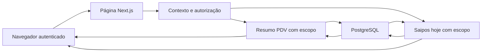

# Painel da operação — modelo de ameaças

## Executive summary

Os resumos do PDV e de Saipos hoje acrescentam leitura de faturamento e pedidos à página autenticada. Os riscos principais são exposição entre unidades, ampliação de permissões e totais financeiros incorretos. A implementação reutiliza a autorização existente, aplica organização e unidade a todas as consultas e não executa comandos operacionais. A revisão estática não identificou bloqueio de segurança na extensão Saipos; os testes locais e a verificação de publicação são evidências distintas, sem alegação de comportamento em produção nesta nota.

## Scope and assumptions

- Escopo: `src/modules/pdv/services/resumo-operacao.ts`, `src/modules/pdv/schemas/resumo-operacao.ts`, `src/app/(shell)/painel/vendas-da-operacao.tsx`, `vendas-atualizacao.tsx` e sua inclusão na página inicial.
- Extensão Saipos: `src/modules/analytics/services/operacao-hoje.ts`, `operacao-hoje.integracao.ts` e `src/app/(shell)/painel/saipos-hoje.tsx`. Somente dados já importados; sem novo webhook, rota pública, configuração, consulta externa ou escrita.
- Contexto confirmado pelas orientações do projeto: aplicação Next.js exposta pela internet, sessão Auth.js, dados de várias organizações/unidades e publicação de `main` pelo Dokploy. Não há mudança autorizada de permissões.
- Fora do escopo: autenticação existente, criação/recebimento/cancelamento de vendas, conectores, migrações, exportação financeira existente e infraestrutura. Foram consultados como evidência quando atravessados pela nova leitura.
- Não há pergunta de contexto pendente que altere a classificação. `Faturamento PDV` significa o total de vendas atualmente concluídas, selecionadas pela data de criação, como no histórico existente; não significa fluxo de recebimentos nem soma com Saipos.
- O usuário acompanha PDV e Saipos. Não há confirmação de liberação de um feed operacional Saipos de todas as vendas. Saipos hoje é parcial por turno e pode atrasar até D+1; não equivale a pedidos em andamento. A cadência de importação existente permanece em 15 minutos, independente da atualização visual a cada 30 segundos.

## System model

### Primary components

O navegador recebe a página autenticada; o servidor monta `ContextoSessao`, chama `consultarResumoOperacao` e consulta PostgreSQL por Prisma. A interface recebe totais, etapas e até cinco números de pedido, sem nomes de clientes ou conteúdo de pagamentos. Evidências: `src/core/sessao/contexto.ts: obterContexto`, `src/modules/pdv/services/resumo-operacao.ts: consultarResumoOperacao`.

Saipos hoje chama `consultarOperacaoSaiposHoje` no servidor: agrega vendas não canceladas do turno atual em Brasília, conta canceladas separadamente e seleciona até cinco vendas recentes, incluindo canceladas identificadas. A lista contém ID, código externo, horário, valor, canal e modalidade; não seleciona cadastro de cliente, pagamentos, itens ou histórico bruto. Vínculo, totais e lista são lidos no mesmo snapshot. Evidência: `src/modules/analytics/services/operacao-hoje.ts`.

### Data flows and trust boundaries

- Navegador → servidor Next.js: sessão e navegação/atualização via HTTPS em produção. `obterContexto` lê Auth.js e monta os acessos atuais; o cliente não fornece organização, unidade ou intervalo à nova função.
- Contexto autenticado → serviço PDV: `exigirEscopo` exige `pdv.ver`, unidade ativa pertencente aos acessos visíveis e registro ativo da mesma organização. Evidência: `src/modules/pdv/services/escopo.ts`.
- Contexto autenticado → serviço Saipos hoje: exige `analytics.ver`, unidade ativa visível e valida no banco a unidade e a organização ativas. Todas as quatro consultas incluem organização, unidade e exclusão lógica; o snapshot usa `RepeatableRead`. Evidência: `src/modules/analytics/services/operacao-hoje.ts`.
- Serviço → PostgreSQL: Prisma recebe filtros com ambos os IDs. Agregações e lista rodam em transação `RepeatableRead`; relações pedido/venda usam chaves compostas de escopo. Evidências: `resumo-operacao.ts`, `prisma/schema/pdv.prisma: PdvPedido.venda`.
- Servidor → navegador: apenas o resumo autorizado é renderizado. Links abrem rotas existentes que verificam o próprio acesso. O temporizador chama `router.refresh()` a cada 30 segundos enquanto a aba está visível e sem atualização pendente; não chama ações de venda ou pagamento.
- Origem externa → banco já importado: a extensão não atravessa essa fronteira em runtime. O worker existente mantém suas credenciais e cadência; o painel mostra o último sucesso de importação separado do horário de consulta à tela. Aviso parcial/D+1 permanece junto dos valores e a interface não soma Saipos e PDV. Evidências: `painel/saipos-hoje.tsx`, `painel/vendas-da-operacao.tsx`, `src/connectors/saipos/tempo.ts`.

#### Diagram

## Assets and security objectives

| Asset                             | Why it matters                                    | Security objective (C/I/A) |
| --------------------------------- | ------------------------------------------------- | -------------------------- |
| Totais financeiros da unidade     | Dados operacionais privados orientam decisões     | C, I                       |
| Número e etapa dos pedidos        | Expõem a atividade da loja                        | C, I                       |
| Pedidos, pagamentos e estoque     | Abrir ou atualizar um painel não deve alterá-los  | I                          |
| Banco e disponibilidade do painel | Atualizações periódicas geram consultas repetidas | A                          |

## Attacker model

### Capabilities

Visitante sem sessão pode solicitar a página. Usuário autenticado pode alterar URLs, atualizar repetidamente, abrir várias abas e ter acesso a uma unidade diferente da pretendida. Conteúdo visível pode conter texto originalmente cadastrado por operadores.

### Non-capabilities

O navegador não escolhe os argumentos internos dos serviços de resumo, não substitui o `ContextoSessao` montado no servidor e não executa SQL. Não se pressupõe comprometimento de sessão, servidor ou banco. Os resumos não entregam dados de cartão, identificadores de clientes ou credenciais. Texto de canal vindo da importação é renderizado como texto pelo React, sem HTML bruto.

## Entry points and attack surfaces

| Surface                      | How reached           | Trust boundary       | Notes                                                                  | Evidence                                            |
| ---------------------------- | --------------------- | -------------------- | ---------------------------------------------------------------------- | --------------------------------------------------- |
| Página inicial               | Navegação e refresh   | Internet → aplicação | Contexto obtido no servidor; sem novo endpoint público                 | `src/app/(shell)/page.tsx`                          |
| Consulta de resumo           | Componente servidor   | Sessão → dados PDV   | `pdv.ver` e escopo revalidados                                         | `services/resumo-operacao.ts`, `services/escopo.ts` |
| Saipos hoje                  | Componente servidor   | Sessão → importados  | `analytics.ver`, unidade/organização ativas, snapshot e cinco detalhes | `analytics/services/operacao-hoje.ts`               |
| Atualização periódica/manual | Temporizador ou botão | Navegador → servidor | 30 s, aba visível, sem concorrência deliberada na mesma instância      | `painel/vendas-atualizacao.tsx`                     |
| Histórico e desempenho       | Links do resumo       | Página → módulos     | Intervalos explícitos; autorização própria das rotas                   | `pdv/vendas/page.tsx`, `pdv/desempenho/page.tsx`    |

## Top abuse paths

1. Ler outra unidade → adulterar cookie/URL → tentar ampliar os totais consultados. O contexto e `exigirEscopo` impedem usar unidade fora dos acessos e da organização.
2. Obter faturamento sem acesso ao PDV → acessar diretamente a página → tentar contornar a ocultação visual. O serviço exige `pdv.ver` novamente; acesso apenas a Analytics não satisfaz essa permissão.
3. Inflar receita → incluir pendentes, canceladas, registros futuros ou fontes duplicadas → induzir decisão incorreta. O filtro usa `CONCLUIDA`, janela civil de Brasília limitada ao instante da consulta e somente `PdvVenda` para faturamento.
4. Alterar a operação abrindo o painel → disparar processamento de recebimentos ou agendamentos por refresh → modificar estado sem ação explícita. O serviço novo contém apenas agregações, contagens e leitura; não chama esses processadores.
5. Degradar disponibilidade → manter muitas sessões/abas atualizando → multiplicar consultas. Intervalos fixos e suspensão em abas ocultas reduzem a carga normal; não constituem limitação de requisições contra abuso autenticado.
6. Interpretar dado atrasado como operação ao vivo → tratar sucesso da importação como completude ou somar fontes sobrepostas → superestimar faturamento. A interface distingue turno Saipos de dia civil PDV, marca Saipos como parcial com possível D+1, separa horário de importação do de consulta e não calcula total combinado. Não deriva etapa operacional do histórico atrasado.

## Threat model table

| Threat ID | Threat source                                    | Prerequisites                                    | Threat action                                             | Impact                                     | Impacted assets         | Existing controls (evidence)                                                                                                       | Gaps                                                                     | Recommended mitigations                                                         | Detection ideas                                          | Likelihood              | Impact severity | Priority |
| --------- | ------------------------------------------------ | ------------------------------------------------ | --------------------------------------------------------- | ------------------------------------------ | ----------------------- | ---------------------------------------------------------------------------------------------------------------------------------- | ------------------------------------------------------------------------ | ------------------------------------------------------------------------------- | -------------------------------------------------------- | ----------------------- | --------------- | -------- |
| TM-001    | Usuário de outra unidade                         | Sessão válida                                    | Consultar escopo indevido                                 | Exposição entre lojas                      | Totais e pedidos        | `exigirEscopo`; filtros com organização/unidade; FK composta; integração local confirma isolamento e recusa organização forjada    | Nenhuma lacuna demonstrada no cenário integrado                          | Preservar os cenários de outra organização/unidade ao evoluir o serviço         | Falhas de autorização e revisão de filtros               | baixa com controles     | alta            | low      |
| TM-002    | Usuário sem `pdv.ver`                            | Sessão com outros módulos                        | Contornar ocultação visual                                | Ampliação de acesso                        | Faturamento             | Checagem no componente e em `exigirEscopo`                                                                                         | Nenhuma ampliação encontrada; a permissão já permite histórico monetário | Preservar a checagem do serviço em futuras reutilizações                        | Teste de perfil sem permissão                            | baixa                   | alta            | low      |
| TM-003    | Dados operacionais incompatíveis                 | Pendentes/canceladas ou datas limítrofes         | Misturar populações e períodos                            | Total enganoso                             | Integridade do resumo   | `CONCLUIDA`, início civil em Brasília, limite `lte agora`, fontes separadas, `RepeatableRead`                                      | Data de criação difere de data de recebimento                            | Manter a definição explícita; testar recebimento tardio se o conceito mudar     | Comparar com histórico com os mesmos filtros             | baixa                   | média           | low      |
| TM-004    | Navegação ou atualização                         | Usuário abre o painel                            | Executar comando operacional durante leitura              | Mudança involuntária de pedidos/pagamentos | Integridade da operação | Novo serviço somente leitura; integração preserva status, versão, eventos e atualizadoEm de agendado vencido                       | Futuras dependências podem introduzir efeitos                            | Preservar a consulta isolada e revisar chamadas adicionadas                     | Comparar estado antes/depois em integração               | baixa                   | alta            | low      |
| TM-005    | Usuário autenticado abusivo                      | Muitas sessões/requisições                       | Multiplicar refreshes                                     | Carga e latência                           | Disponibilidade         | Janela fixa de 7 dias, índices por escopo/data/status, cinco detalhes, pausa em aba oculta                                         | Sem rate limit específico; refresh atualiza a página inteira             | Monitorar latência e conexões; aplicar limite por sessão se houver abuso medido | Métricas de duração, frequência e conexões               | baixa no uso esperado   | média           | low      |
| TM-006    | Usuário sem `analytics.ver` ou com outra unidade | Sessão válida                                    | Contornar a ocultação do bloco Saipos                     | Exposição de vendas importadas             | Totais e vendas Saipos  | Permissão e unidade visível revalidadas; unidade/organização ativas; todos os filtros com ambos IDs; select limitado               | Nenhuma lacuna identificada na revisão estática                          | Preservar integração de permissões e escopo                                     | Falhas de autorização e revisão de filtros               | baixa com controles     | alta            | low      |
| TM-007    | Atraso ou sobreposição de dados de origem        | Dados recentes parciais ou venda nas duas fontes | Interpretar importação como feed completo ou somar fontes | Decisão financeira incorreta               | Integridade do resumo   | Turno explícito; limite de criação até consulta; canceladas fora dos totais; D+1 visível; timestamps separados; fontes não somadas | API não garante completude nem etapa atual em tempo real                 | Manter o aviso e só agregar fontes após deduplicação comprovada                 | Comparação por mesma loja e turno no relatório da origem | média inerente à origem | média           | low      |

## Criticality calibration

- **critical:** acesso irrestrito ao banco ou execução remota; alteração arbitrária de pagamentos entre organizações. Não identificados nesta mudança.
- **high:** exposição confirmada entre organizações; consulta financeira que ignore `pdv.ver`.
- **medium:** totais financeiros materialmente incorretos; degradação sustentada por consultas autenticadas.
- **low:** risco residual contido pelas checagens existentes; futura regressão coberta pelos cenários de integração; ambiguidade de período esclarecida na interface.

## Focus paths for security review

| Path                                              | Why it matters                                               | Related Threat IDs             |
| ------------------------------------------------- | ------------------------------------------------------------ | ------------------------------ |
| `src/modules/pdv/services/escopo.ts`              | Autoriza permissão e vínculo da unidade à organização        | TM-001, TM-002                 |
| `src/modules/pdv/schemas/resumo-operacao.ts`      | Define população, status e janela de Brasília                | TM-001, TM-003                 |
| `src/modules/pdv/services/resumo-operacao.ts`     | Mantém consultas com escopo e transação consistente          | TM-001, TM-003, TM-004, TM-005 |
| `src/app/(shell)/painel/vendas-atualizacao.tsx`   | Limita atualizações normais e usa apenas refresh             | TM-004, TM-005                 |
| `src/app/(shell)/painel/vendas-da-operacao.tsx`   | Explicita origem e transmite apenas o resumo autorizado      | TM-002, TM-003                 |
| `src/modules/analytics/services/operacao-hoje.ts` | Permissão Analytics, escopo, snapshot e allowlist de dados   | TM-006, TM-007                 |
| `src/app/(shell)/painel/saipos-hoje.tsx`          | Parcialidade, canceladas, turno e horário real de importação | TM-006, TM-007                 |

## Notes on use

Entradas e fronteiras descobertas estão representadas acima. Contexto confirmado pelo projeto, sem perguntas pendentes. A evidência de runtime combina revisão estática, testes de filtros em `src/modules/pdv/schemas/resumo-operacao.test.ts` e integração real em `src/modules/pdv/services/resumo-operacao.integracao.ts`, aprovada em banco PostgreSQL local exclusivo `_test` (1/1), com dados fictícios e o servidor de desenvolvimento parado para isolar o worker de agendamentos.

A integração confirma isolamento entre organizações e unidades; recusa falta de `pdv.ver`, unidade ausente, unidade não visível e organização forjada; confere faturamento de hoje e sete dias sem canceladas, pendentes ou registros futuros; limita os detalhes a cinco pedidos sem PII; e comprova que a consulta mantém status, versão, eventos e `atualizadoEm` de um pedido agendado com preparo vencido. Não foi teste de produção. A execução de `npm run check`, build e confirmação de deploy é registrada no fechamento da tarefa principal.

O teste novo `src/modules/analytics/services/operacao-hoje.integracao.ts` foi aprovado (1/1) em PostgreSQL local exclusivo `_test`, com dados fictícios. Cobre virada de dia em Brasília, turno, canceladas, registro futuro/excluído, limite de cinco e campos selecionados; recusa falta de permissão, unidade ausente/não visível/inativa e organização forjada/inativa; compara vínculo e vendas antes/depois para detectar escrita. Não foi teste de produção.

A limitação D+1 foi reconfirmada na [FAQ oficial da API de Dados](https://saipos-data-api.readme.io/reference/duvidas-frequentes). A [documentação de filtros](https://saipos-data-api.readme.io/reference/funcionamento-filtros-consultas) distingue criação, alteração e turno; nenhuma dessas opções garante completude em tempo real. Não houve ativação de API de Pedidos, promoção de homologação ou mudança no worker nesta extensão.
