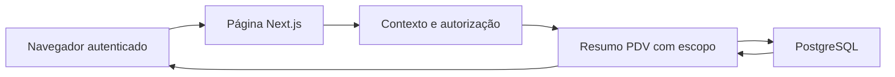

# Painel da operação — modelo de ameaças

## Executive summary

O novo resumo do PDV acrescenta leitura de faturamento e pedidos à página autenticada. Os riscos principais são exposição entre unidades, ampliação de permissões e totais financeiros incorretos. A implementação reutiliza a autorização existente, aplica organização e unidade a todas as consultas e não executa comandos operacionais. A revisão estática e o teste de integração local aprovado (1/1) não identificaram bloqueio de segurança nas novas consultas; não comprovam publicação ou comportamento em produção.

## Scope and assumptions

- Escopo: `src/modules/pdv/services/resumo-operacao.ts`, `src/modules/pdv/schemas/resumo-operacao.ts`, `src/app/(shell)/painel/vendas-da-operacao.tsx`, `vendas-atualizacao.tsx` e sua inclusão na página inicial.
- Contexto confirmado pelas orientações do projeto: aplicação Next.js exposta pela internet, sessão Auth.js, dados de várias organizações/unidades e publicação de `main` pelo Dokploy. Não há mudança autorizada de permissões.
- Fora do escopo: autenticação existente, criação/recebimento/cancelamento de vendas, conectores, migrações, exportação financeira existente e infraestrutura. Foram consultados como evidência quando atravessados pela nova leitura.
- Não há pergunta de contexto pendente que altere a classificação. `Faturamento PDV` significa o total de vendas atualmente concluídas, selecionadas pela data de criação, como no histórico existente; não significa fluxo de recebimentos nem soma com Saipos.

## System model

### Primary components

O navegador recebe a página autenticada; o servidor monta `ContextoSessao`, chama `consultarResumoOperacao` e consulta PostgreSQL por Prisma. A interface recebe totais, etapas e até cinco números de pedido, sem nomes de clientes ou conteúdo de pagamentos. Evidências: `src/core/sessao/contexto.ts: obterContexto`, `src/modules/pdv/services/resumo-operacao.ts: consultarResumoOperacao`.

### Data flows and trust boundaries

- Navegador → servidor Next.js: sessão e navegação/atualização via HTTPS em produção. `obterContexto` lê Auth.js e monta os acessos atuais; o cliente não fornece organização, unidade ou intervalo à nova função.
- Contexto autenticado → serviço PDV: `exigirEscopo` exige `pdv.ver`, unidade ativa pertencente aos acessos visíveis e registro ativo da mesma organização. Evidência: `src/modules/pdv/services/escopo.ts`.
- Serviço → PostgreSQL: Prisma recebe filtros com ambos os IDs. Agregações e lista rodam em transação `RepeatableRead`; relações pedido/venda usam chaves compostas de escopo. Evidências: `resumo-operacao.ts`, `prisma/schema/pdv.prisma: PdvPedido.venda`.
- Servidor → navegador: apenas o resumo autorizado é renderizado. Links abrem rotas existentes que verificam o próprio acesso. O temporizador chama `router.refresh()` a cada 30 segundos enquanto a aba está visível e sem atualização pendente; não chama ações de venda ou pagamento.

#### Diagram

## Assets and security objectives

| Asset                             | Why it matters                                    | Security objective (C/I/A) |
| --------------------------------- | ------------------------------------------------- | -------------------------- |
| Totais financeiros da unidade     | Dados operacionais privados orientam decisões     | C, I                       |
| Número e etapa dos pedidos        | Expõem a atividade da loja                        | C, I                       |
| Pedidos, pagamentos e estoque     | Abrir ou atualizar um painel não deve alterá-los  | I                          |
| Banco e disponibilidade do painel | Atualizações periódicas geram consultas repetidas | A                          |

## Attacker model

### Capabilities

Visitante sem sessão pode solicitar a página. Usuário autenticado pode alterar URLs, atualizar repetidamente, abrir várias abas e ter acesso a uma unidade diferente da pretendida. Conteúdo visível pode conter texto originalmente cadastrado por operadores.

### Non-capabilities

O navegador não escolhe os argumentos internos de `consultarResumoOperacao`, não substitui o `ContextoSessao` montado no servidor e não executa SQL. Não se pressupõe comprometimento de sessão, servidor ou banco. O resumo não entrega dados de cartão, identificadores de clientes ou credenciais.

## Entry points and attack surfaces

| Surface                      | How reached           | Trust boundary       | Notes                                                             | Evidence                                            |
| ---------------------------- | --------------------- | -------------------- | ----------------------------------------------------------------- | --------------------------------------------------- |
| Página inicial               | Navegação e refresh   | Internet → aplicação | Contexto obtido no servidor; sem novo endpoint público            | `src/app/(shell)/page.tsx`                          |
| Consulta de resumo           | Componente servidor   | Sessão → dados PDV   | `pdv.ver` e escopo revalidados                                    | `services/resumo-operacao.ts`, `services/escopo.ts` |
| Atualização periódica/manual | Temporizador ou botão | Navegador → servidor | 30 s, aba visível, sem concorrência deliberada na mesma instância | `painel/vendas-atualizacao.tsx`                     |
| Histórico e desempenho       | Links do resumo       | Página → módulos     | Intervalos explícitos; autorização própria das rotas              | `pdv/vendas/page.tsx`, `pdv/desempenho/page.tsx`    |

## Top abuse paths

1. Ler outra unidade → adulterar cookie/URL → tentar ampliar os totais consultados. O contexto e `exigirEscopo` impedem usar unidade fora dos acessos e da organização.
2. Obter faturamento sem acesso ao PDV → acessar diretamente a página → tentar contornar a ocultação visual. O serviço exige `pdv.ver` novamente; acesso apenas a Analytics não satisfaz essa permissão.
3. Inflar receita → incluir pendentes, canceladas, registros futuros ou fontes duplicadas → induzir decisão incorreta. O filtro usa `CONCLUIDA`, janela civil de Brasília limitada ao instante da consulta e somente `PdvVenda` para faturamento.
4. Alterar a operação abrindo o painel → disparar processamento de recebimentos ou agendamentos por refresh → modificar estado sem ação explícita. O serviço novo contém apenas agregações, contagens e leitura; não chama esses processadores.
5. Degradar disponibilidade → manter muitas sessões/abas atualizando → multiplicar consultas. Intervalos fixos e suspensão em abas ocultas reduzem a carga normal; não constituem limitação de requisições contra abuso autenticado.

## Threat model table

| Threat ID | Threat source                    | Prerequisites                            | Threat action                                | Impact                                     | Impacted assets         | Existing controls (evidence)                                                                                                    | Gaps                                                                     | Recommended mitigations                                                         | Detection ideas                              | Likelihood            | Impact severity | Priority |
| --------- | -------------------------------- | ---------------------------------------- | -------------------------------------------- | ------------------------------------------ | ----------------------- | ------------------------------------------------------------------------------------------------------------------------------- | ------------------------------------------------------------------------ | ------------------------------------------------------------------------------- | -------------------------------------------- | --------------------- | --------------- | -------- |
| TM-001    | Usuário de outra unidade         | Sessão válida                            | Consultar escopo indevido                    | Exposição entre lojas                      | Totais e pedidos        | `exigirEscopo`; filtros com organização/unidade; FK composta; integração local confirma isolamento e recusa organização forjada | Nenhuma lacuna demonstrada no cenário integrado                          | Preservar os cenários de outra organização/unidade ao evoluir o serviço         | Falhas de autorização e revisão de filtros   | baixa com controles   | alta            | low      |
| TM-002    | Usuário sem `pdv.ver`            | Sessão com outros módulos                | Contornar ocultação visual                   | Ampliação de acesso                        | Faturamento             | Checagem no componente e em `exigirEscopo`                                                                                      | Nenhuma ampliação encontrada; a permissão já permite histórico monetário | Preservar a checagem do serviço em futuras reutilizações                        | Teste de perfil sem permissão                | baixa                 | alta            | low      |
| TM-003    | Dados operacionais incompatíveis | Pendentes/canceladas ou datas limítrofes | Misturar populações e períodos               | Total enganoso                             | Integridade do resumo   | `CONCLUIDA`, início civil em Brasília, limite `lte agora`, fontes separadas, `RepeatableRead`                                   | Data de criação difere de data de recebimento                            | Manter a definição explícita; testar recebimento tardio se o conceito mudar     | Comparar com histórico com os mesmos filtros | baixa                 | média           | low      |
| TM-004    | Navegação ou atualização         | Usuário abre o painel                    | Executar comando operacional durante leitura | Mudança involuntária de pedidos/pagamentos | Integridade da operação | Novo serviço somente leitura; integração preserva status, versão, eventos e atualizadoEm de agendado vencido                    | Futuras dependências podem introduzir efeitos                            | Preservar a consulta isolada e revisar chamadas adicionadas                     | Comparar estado antes/depois em integração   | baixa                 | alta            | low      |
| TM-005    | Usuário autenticado abusivo      | Muitas sessões/requisições               | Multiplicar refreshes                        | Carga e latência                           | Disponibilidade         | Janela fixa de 7 dias, índices por escopo/data/status, cinco detalhes, pausa em aba oculta                                      | Sem rate limit específico; refresh atualiza a página inteira             | Monitorar latência e conexões; aplicar limite por sessão se houver abuso medido | Métricas de duração, frequência e conexões   | baixa no uso esperado | média           | low      |

## Criticality calibration

- **critical:** acesso irrestrito ao banco ou execução remota; alteração arbitrária de pagamentos entre organizações. Não identificados nesta mudança.
- **high:** exposição confirmada entre organizações; consulta financeira que ignore `pdv.ver`.
- **medium:** totais financeiros materialmente incorretos; degradação sustentada por consultas autenticadas.
- **low:** risco residual contido pelas checagens existentes; futura regressão coberta pelos cenários de integração; ambiguidade de período esclarecida na interface.

## Focus paths for security review

| Path                                            | Why it matters                                          | Related Threat IDs             |
| ----------------------------------------------- | ------------------------------------------------------- | ------------------------------ |
| `src/modules/pdv/services/escopo.ts`            | Autoriza permissão e vínculo da unidade à organização   | TM-001, TM-002                 |
| `src/modules/pdv/schemas/resumo-operacao.ts`    | Define população, status e janela de Brasília           | TM-001, TM-003                 |
| `src/modules/pdv/services/resumo-operacao.ts`   | Mantém consultas com escopo e transação consistente     | TM-001, TM-003, TM-004, TM-005 |
| `src/app/(shell)/painel/vendas-atualizacao.tsx` | Limita atualizações normais e usa apenas refresh        | TM-004, TM-005                 |
| `src/app/(shell)/painel/vendas-da-operacao.tsx` | Explicita origem e transmite apenas o resumo autorizado | TM-002, TM-003                 |

## Notes on use

Entradas e fronteiras descobertas estão representadas acima. Contexto confirmado pelo projeto, sem perguntas pendentes. A evidência de runtime combina revisão estática, testes de filtros em `src/modules/pdv/schemas/resumo-operacao.test.ts` e integração real em `src/modules/pdv/services/resumo-operacao.integracao.ts`, aprovada em banco PostgreSQL local exclusivo `_test` (1/1), com dados fictícios e o servidor de desenvolvimento parado para isolar o worker de agendamentos.

A integração confirma isolamento entre organizações e unidades; recusa falta de `pdv.ver`, unidade ausente, unidade não visível e organização forjada; confere faturamento de hoje e sete dias sem canceladas, pendentes ou registros futuros; limita os detalhes a cinco pedidos sem PII; e comprova que a consulta mantém status, versão, eventos e `atualizadoEm` de um pedido agendado com preparo vencido. Não foi teste de produção. A execução de `npm run check`, build e confirmação de deploy é registrada no fechamento da tarefa principal.
