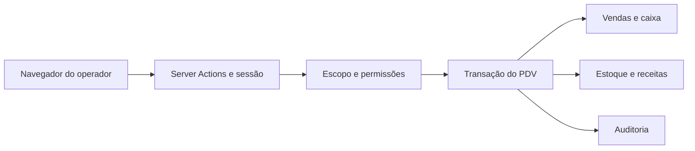

# Modelo de ameaças do PDV

## Escopo e contexto confirmado

Módulo interno de produtos, online, para uso próprio, sem fiscal ou processador de pagamentos. Aplicação Next.js existente publicada no Dokploy, usando a sessão Auth.js e o banco PostgreSQL existentes. Os valores de Pix/cartão são registros manuais, não provas de liquidação. Confirmação de escopo dada na conversa de 27/10/2026. Acesso externo ao Tetteo já existe; não são criados novos canais públicos.

Ativos: integridade das vendas, estoque, dinheiro em caixa, identificação de clientes e trilha de auditoria. Atacante relevante: operador autenticado tentando exceder suas permissões, manipular payloads ou repetir requisições; visitante sem sessão tentando invocar ações. Administrador do banco/VPS já pode alterar dados e está fora desse modelo.

## Fronteiras e evidências

- Navegador → servidor: `src/modules/pdv/acoes.ts`; sessão obtida no servidor, payload validado com Zod em `schemas/venda.ts`.
- Sessão → organização/unidade: `core/sessao/contexto.ts` e `services/pdv.ts`, função `exigirEscopo`. IDs do navegador não são autorização.
- Operação → persistência: `services/pdv.ts`; valores e composição são obtidos do catálogo do banco; caixa, venda, estoque e auditoria usam transação.
- Escritas simultâneas → estado de caixa: trava transacional por organização/unidade e restrição de caixa aberto na migração PDV.
- Receita atual → história: snapshots de itens, pagamentos e consumo na venda. Cancelamento reverte o consumo registrado.

## Abusos, prioridade e controles

| Abuso                                                           | Probabilidade / impacto | Prioridade | Controle                                                                                                     |
| --------------------------------------------------------------- | ----------------------- | ---------- | ------------------------------------------------------------------------------------------------------------ |
| Trocar IDs para acessar outra loja ou cliente                   | Média / alto            | Alta       | Escopo servidor e consultas por organização/unidade, validação de caixa, local e cliente                     |
| Enviar preço negativo, desconto indevido ou complementos falsos | Média / alto            | Alta       | Centavos inteiros limitados, preços recalculados, grupos min/max, IDs únicos e permissão de desconto         |
| Repetir venda após perda de resposta                            | Alta / alto             | Alta       | Chave idempotente única no escopo e hash do payload; replay não consome estoque novamente                    |
| Fechar caixa junto com venda ou abrir dois caixas               | Média / alto            | Alta       | Operações serializadas por trava no banco e unicidade de caixa aberto                                        |
| Cancelar sem autorização ou mudar receita para ganhar estoque   | Média / alto            | Alta       | Permissão, motivo, caixa aberto e estorno pelo snapshot, com auditoria                                       |
| Marcar Pix/cartão sem pagamento real                            | Média / médio           | Média      | Registro manual explícito na interface; conferência operacional necessária, sem simular confirmação bancária |
| Expor clientes em dados de teste ou capturas versionadas        | Baixa / alto            | Média      | Fixtures locais fictícias; capturas e credenciais não incluídas no commit                                    |

## Riscos residuais e validação

### Clientes e endereços no atendimento

O contexto confirmado continua sendo operação interna online, com sessão existente e dados pessoais reais somente no ambiente autorizado. O CRM é o proprietário do cadastro: `crm/services/atendimento.ts`, `atendimento-routes.ts` e `schemas/atendimento.ts` fornecem pesquisa paginada, criação de cliente e manutenção de endereços. O PDV consome a API autenticada, sem importar serviços de outro módulo. A seleção é explícita; o endereço escolhido é copiado para o rascunho/snapshot operacional e não cria vínculo entre cadastros por semelhança de nome ou telefone.

A fronteira navegador → `/api/crm/atendimento/clientes` conserva sessão, unidade ativa, `crm.ver`, `crm.editar` nas escritas, origem autorizada, limite de corpo e limite por ator do handler CRM. O router não autentica uma requisição HTTP por conta própria: recebe somente o `CrmUser` derivado no servidor. O serviço também verifica permissões, acesso à unidade e unidade/organização ativas; contato deve estar ativo e sem fusão. DTOs explícitos não incluem notas, e-mail, consentimentos ou identidades verificadas. Não há consulta pública por telefone.

| Abuso                                                                                | Probabilidade / impacto | Prioridade | Controle e evidência                                                                                                                                                                                                                                                                       |
| ------------------------------------------------------------------------------------ | ----------------------- | ---------- | ------------------------------------------------------------------------------------------------------------------------------------------------------------------------------------------------------------------------------------------------------------------------------------------ |
| Trocar unidade, cliente ou endereço para obter PII de outra loja                     | Média / alto            | Alta       | Serviço exige acesso à unidade; contato/endereço são consultados com unidade e cliente. Migração `20261027210000_crm_enderecos_atendimento` usa FKs compostas, sem aceitar IDs como autorização.                                                                                           |
| Reenviar criação para substituir a identidade ou fabricar consentimento de marketing | Média / alto            | Alta       | Telefone normalizado é único por loja; duplicata gera conflito e não sobrescreve nome/telefone. Cliente novo usa `marketingOptIn:false`; schema estrito recusa campos extras. Nenhuma identidade ou consentimento é criado. Duplicata arquivada/fundida não devolve DTO do cliente.        |
| Resposta perdida criar duplicação ou replay de outro operador recuperar PII          | Média / médio           | Média      | Trava por loja e chave única de operação; tipo, ator e hash devem coincidir. Retry usa referências e versão/instante do resultado; alteração posterior exige nova consulta, em vez de recuperar snapshot antigo. A tabela de operações não guarda cópia de endereço/telefone.              |
| Duas abas perderem alterações ou definirem dois endereços principais                 | Média / médio           | Média      | Versão otimista e trava transacional; troca de principal incrementa também a versão do endereço anterior. Índice parcial garante um principal ativo por cliente. Arquivamento é lógico e endereço inativo não pode ser principal. Limite de 20 endereços ativos também vale na reativação. |
| Pesquisa ou auditoria ampliarem exposição de dados pessoais                          | Média / médio           | Média      | Pesquisa executada no banco com página de 20, não truncada aos primeiros 500; retorno privado sem cache. Busca literal escapa curingas SQL. Auditoria registra campos/IDs/versões e não valores de nome, telefone ou endereço.                                                             |

Quando o próprio replay autorizado encontra um cadastro posteriormente alterado/arquivado, o erro informa `operacaoConfirmada:true` sem repetir a escrita ou devolver PII antiga. A interface pode encerrar explicitamente a tentativa e reler o cadastro. Essa confirmação não existe em chave de outro ator/hash nem em conflito comum de versão, evitando transformar uma rejeição em prova de operação realizada.

Riscos residuais: `crm.ver` já autoriza consultar cadastro e endereços nesta unidade; a nova tela não substitui governança de papéis. Operador autorizado pode copiar ou digitar dados incorretos. Cadastro de telefone não prova posse, endereço não é validado geograficamente e criação não autoriza comunicação de marketing. O serviço não altera automaticamente vendas já finalizadas nem seus snapshots. O banco e backups continuam contendo PII sob os controles existentes; auditoria sem valores não apaga o cadastro de origem. Testes independentes usam somente lojas/pessoas fictícias isoladas no PostgreSQL local `_test` e exercitam router/serviço; sessão/CSRF HTTP permanecem validados separadamente no handler e na navegação.

### Vendas, produção e documentos

Pagamento pendente separa o fato de produção do recebimento (`services/recebimentos.ts`, `acoes-recebimentos.ts`). Ambos exigem organização/unidade e permissões no servidor. Criar pendente valida catálogo, estoque e caixa de origem; receber valida somente total congelado, versão financeira, meios e caixa atual. O consumo não é recalculado. A consulta de recebimento usa DTO permitido, sem o JSON de endereço/telefone, e cliente continua condicionado a `crm.ver`.

Cobrança duplicada, cobrança junto a cancelamento e fechamento concorrente usam a mesma trava transacional por unidade. Uma chave de recebimento tem unicidade no escopo e hash de payload; replay exige também o mesmo operador e é verificado antes do estado atual, evitando perder a confirmação após fechamento/cancelamento. A versão financeira e a versão operacional incrementada no recebimento rejeitam cancelamento a partir de cartão antigo. Retentativa incerta conserva payload/chave na interface; erro conhecido exige reconsulta explícita.

O caixa de recebimento tem FK composta por organização/unidade, distinta do caixa/local original de estoque. Somatórios concatenam recebimentos explícitos e legados sem vínculo, conjuntos disjuntos; pendentes e cancelados não contam como dinheiro recebido. Cancelar pendente depois de fechar a origem apenas estorna o consumo congelado; cancelar pago exige o caixa do recebimento aberto, preservando fechamentos. Não há confirmação bancária, cobrança automática ou valores parciais persistidos. A operação física de devolução e perda de ingredientes continua responsabilidade da loja.

Delivery adiciona endereço/telefone estruturados ao snapshot da venda e ao carrinho do autor. A captura é autorizada por `pdv.vender`; leitura no quadro/comprovante exige `pdv.entrega` e escopo servidor. A via de cozinha nunca serializa esses campos, e o CSV permanece sem contato/endereço. Não há chamadas a mapas, CEP, WhatsApp ou motoboy, nem canal público de rastreamento. Persistência usa o banco já existente; leitura direta por administradores do banco e guarda do papel/PDF continuam limites da aplicação.

`services/entregas.ts` confere área ativa, versão e cobertura de cidade/UF/bairro na mesma transação da venda e compara o frete/prazo exibidos com o cadastro. Não aceita reprecificação silenciosa. Manual exige justificativa, sem conferir geograficamente o endereço. `services/pdv.ts` soma frete separado da taxa adicional; o CHECK do banco inclui os dois e preserva legados com frete zero. Replay de venda anterior ocorre antes da exigência de endereço novo. Carrinhos guardam endereço/vínculo de área sem cotação e exigem nova conferência.

Áreas/entregadores têm escopo, atividade e versão; não são apagados. Atribuição usa a mesma trava por unidade de venda/cancelamento/avanço e FK composta por organização/unidade/entregador. Só aceita pedido de entrega ativo antes da saída; retry verifica evento, operador e alvo. A saída de nova entrega exige `pdv.operar`, `pdv.entrega` e entregador ativo. Endereço/telefone estruturados não são copiados para a auditoria, que registra IDs, versões e fatos operacionais. A nova permissão não é concedida automaticamente a papéis existentes.

O histórico ampliado (`services/historico.ts`, `acoes-historico.ts`) valida filtros/datas, exige `pdv.ver` e restringe todas as consultas por organização/unidade. Paginação, contagem e totais usam o mesmo snapshot transacional. Exportação usa o filtro integral com limite explícito de 5.000 vendas, audita quantidade/escopo sem gravar o termo buscado e neutraliza fórmulas no CSV. Resultados, busca e CSV só incluem o cliente congelado com `crm.ver`; não consultam endereços/telefones. A permissão de consulta permite exportar esse mesmo conjunto: não foi ampliado acesso de papéis.

A rota dedicada de impressão (`src/app/pdv/imprimir/[vendaId]/page.tsx`) e a ação em `impressao-acoes.ts` verificam sessão e escopo em cada acesso. O payload é construído por lista explícita de campos em `schemas/impressao.ts`: cozinha não serializa valores/pagamentos, e cliente exige `crm.ver`. Identificadores/tipo da URL não fornecem dados de impressão. A solicitação refaz a leitura autorizada, usa chave idempotente vinculada ao operador/escopo e trava transacional por venda/tipo antes da auditoria. Prévia é leitura; solicitação/reimpressão é auditada como acesso, nunca como prova de impressão física. O papel/PDF escolhido pelo operador sai do controle do aplicativo e deve ser tratado como o próprio documento de venda já autorizado.

Na gestão de pedidos, a fila usa `PdvPedido` e eventos ligados por organização/unidade/venda, com unicidade da venda e número por unidade. Entradas em `services/pedidos.ts` e `acoes-pedidos.ts` verificam sessão e escopo; leitura exige `pdv.ver`, avanço exige `pdv.operar`. `schemas/pedido.ts` permite apenas a próxima etapa da modalidade; estados terminais não voltam à cozinha. Versão e trava de unidade protegem contra dois operadores avançando o mesmo cartão.

O cancelamento permanece em `services/pdv.ts`, com `pdv.cancelar`, versão opcional do pedido validada antes de qualquer estorno e atualização financeira/estoque/fila/eventos na mesma transação. Uma corrida entre avançar e cancelar não pode confirmar duas alterações da mesma versão. Vendas antigas não são convertidas em produção pela migração. Polling autenticado tem limites de resultados, uma consulta por vez e invalidação de respostas antigas antes de aplicar mudanças na interface. A numeração legível nunca substitui IDs opacos e escopo de autorização.

Na evolução de preparação e carrinhos, o diagnóstico administrativo exige também `pdv.configurar`. Carrinhos persistidos em `pdv_carrinho` usam organização, unidade e autor em toda consulta, não contêm pagamentos ou preços e têm limite de 20 ativos por operador/unidade. As referências de clientes exigem `crm.ver`; a retomada valida novamente o catálogo sem apagar o conteúdo recusado.

`services/carrinhos.ts` serializa save/discard pela mesma trava da venda; versão otimista impede perda de alterações entre abas. Hash da tentativa recupera confirmação de salvamento sem duplicação. `finalizarVenda` confere estado, autor e versão e conclui o carrinho na mesma transação da baixa de estoque. Chaves diferentes para o mesmo carrinho não podem produzir duas vendas. Descarte é lógico e auditado. Testes locais cobrem também concorrência salvar/concluir, retorno de confirmação e tentativas de outro operador/unidade.

Um usuário autorizado a registrar pagamentos manuais pode registrar valores incorretos. O fechamento expõe diferenças de dinheiro, mas não comprova liquidação de cartão/Pix. Não há contingência offline; recarregar/fechar a tela pode perder itens não salvos. O cadastro incorreto de receitas ou vínculos de complementos altera consumo futuro e exige revisão operacional. Não há devolução parcial ou após fechamento nesta entrega.

Validação obrigatória: testes de domínio de preços/troco/complementos, integração local de isolamento, repetição, concorrência e baixa/estorno, navegação Playwright com usuário fictício, `npm run check` e `npm run build`. Nenhum teste usa banco de produção. O relatório descreve controles implementados; resultados executados são informados no encerramento da tarefa.
