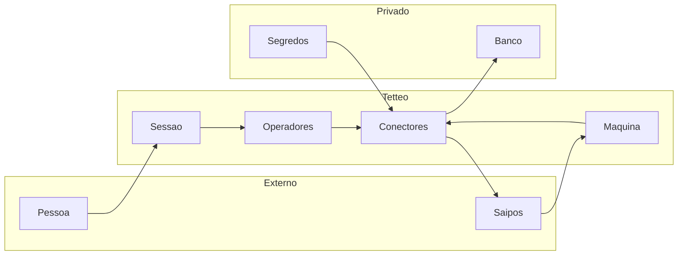

## Executive summary

A integração acrescenta chamadas de saída para a Saipos e uma entrada pública
de máquina. Os riscos centrais são exposição de credenciais/dados pessoais,
troca de unidade e duplicação de operações após timeout. A implementação usa
escopo no servidor e FK composta, cifra autenticada, reserva persistida antes do
envio e ausência de repetição automática de mutações. Pedidos e logística
permanecem em homologação e sem ativação automática de credenciais.

## Scope and assumptions

Escopo: `src/connectors/saipos/`, `src/app/api/saipos/`, painel em
`src/app/(shell)/configuracoes/integracoes/saipos/`, `src/proxy.ts` e migração
`20261026100000_saipos_operacoes`. Fora do escopo: segurança interna da Saipos,
processamento de pagamentos, GPS, infraestrutura de terceiros e auditoria geral
dos módulos preexistentes.

O usuário confirmou em 26/10/2026: implantação no domínio atual, início em
homologação, configuração/operação restrita ao diretor e isolamento por unidade.
O serviço tem um canal/merchant de operações para uma unidade. A API de Dados
existente mantém seu vínculo separado. A publicação do código não comprova
homologação nem autorização de produção na Saipos.

Pendências externas: credenciais corretas por ambiente, cadastro das URLs,
versão do contrato aceita pelo fornecedor e redação da URL de capacidade nos
logs do proxy antes de ativar o callback de Pedidos. Não se assume que uma
resposta bem-sucedida da API de Dados certifique completude na origem.

## System model

### Primary components

- Auth.js/contexto: identidade, diretor e unidade ativa.
- Console e API de operadores: consultas, pedidos e tracking.
- Entrada de máquina: token OAuth, entregas, cancelamento e eventos.
- Conectores: validação Zod, destinos fixos HTTPS e controle de falhas.
- PostgreSQL: registros de operação, unicidade, snapshots e auditoria.

### Data flows and trust boundaries

- Navegador → API de operadores: JSON via HTTPS; sessão, diretor, unidade ativa
  e Origin da própria aplicação (`operacoes/route.ts`, `escopoOperacao`).
- Saipos → entrada de máquina: payload limitado; Bearer de uma hora, cliente e
  ambiente vinculados; merchant e unidade ativa conferidos (`maquina/route.ts`).
- Callback de Pedidos → registros: segredo de capacidade de 256 bits e pedido
  conhecido; loja validada; eventos deduplicados. Não há alegação de assinatura
  oferecida pelo fornecedor quando o contrato não a define.
- Conector → Saipos: hosts fixos, TLS, redirects recusados, timeout e assinatura
  HMAC-SHA256 do corpo exato no tracking (`pedidos.ts`, `logistica.ts`).
- Conector → PostgreSQL: FK organização/unidade; chave única por ambiente;
  AES-256-GCM com AAD do escopo para conteúdo de pedidos e entregas; auditoria
  sem corpo ou segredo (`operacao-repositorio.ts`, `operacao-seguranca.ts`).

#### Diagram

## Assets and security objectives

| Asset                                 | Why it matters                       | Security objective |
| ------------------------------------- | ------------------------------------ | ------------------ |
| Secret/token/chave de cifra           | Autoriza chamadas e protege conteúdo | C, I               |
| Endereço, telefone e pedidos          | Dados privados do cliente/unidade    | C                  |
| Vínculos organização/unidade/merchant | Evita operação em loja errada        | C, I               |
| Pedidos, entregas e respectivos IDs   | Evita duplicação e estado incorreto  | I, A               |
| Cursor e auditoria                    | Retomada e rastreabilidade           | I, A               |

## Attacker model

### Capabilities

Um visitante pode atingir a entrada de máquina, repetir chamadas, enviar JSON
malformado e tentar adivinhar credenciais. Um usuário autenticado sem papel de
diretor pode tentar chamadas diretas. Um cliente logístico comprometido pode
atuar apenas dentro da credencial/merchant configurados. Respostas do fornecedor
podem atrasar, chegar repetidas ou ter contrato inesperado.

### Non-capabilities

Não se presume acesso administrativo ao banco, quebra de TLS/AES/HMAC ou posse
prévia dos segredos. O atacante não pode selecionar uma URL arbitrária de saída.
Testes usam transporte controlado e banco local exclusivo, sem dados reais.

## Entry points and attack surfaces

| Surface                     | How reached          | Trust boundary        | Notes                         | Evidence                            |
| --------------------------- | -------------------- | --------------------- | ----------------------------- | ----------------------------------- |
| Console de integração       | Sessão do navegador  | Pessoa → servidor     | Diretor/unidade               | `saipos/page.tsx`, `escopoOperacao` |
| API de operadores           | POST autenticado     | Navegador → conector  | Origin conferida              | `api/saipos/operacoes/route.ts`     |
| OAuth da logística          | POST público         | Internet → máquina    | Segredo forte, grant limitado | `maquina/[...caminho]/route.ts`     |
| Entrega/cancelamento/coleta | POST com Bearer      | Saipos → máquina      | Merchant conferido            | `logistica.ts`                      |
| Callback de Pedidos         | POST com capacidade  | Internet → máquina    | Desativado sem chave forte    | `registrarEventoPedido`             |
| Resposta remota             | HTTPS de hosts fixos | Fornecedor → conector | Validação e timeout           | `client.ts`, `pedidos.ts`           |

## Top abuse paths

1. Visitante tenta usar a exceção de máquina para enviar pedidos → chama a API
   de operadores → proxy e sessão continuam obrigatórios → envio recusado.
2. Operador tenta trocar a unidade no payload → servidor fixa o escopo e o
   cod_store → FK e vínculo impedem acesso cruzado.
3. Chamada de criação sofre timeout → cliente repete → chave persistida mantém
   o registro original → não há segundo envio automático.
4. Um callback atrasado tenta regredir o estado → evento é guardado no histórico
   sem substituir o estado canônico por ordem de chegada.
5. Um tracking concorre com cancelamento → a versão da entrega muda → confirmação
   remota não sobrescreve cancelamento local concorrente.
6. Uma URL de capacidade aparece em log → terceiro pode forjar evento conhecido
   dessa integração → redação prévia dos logs e não ativação sem essa condição
   são necessárias; a capacidade não é apresentada como assinatura do fornecedor.

## Threat model table

| Threat ID | Threat source                    | Prerequisites                      | Threat action                              | Impact                        | Impacted assets         | Existing controls (evidence)                                       | Gaps                                                 | Recommended mitigations                                                       | Detection ideas                                   | Likelihood | Impact severity | Priority |
| --------- | -------------------------------- | ---------------------------------- | ------------------------------------------ | ----------------------------- | ----------------------- | ------------------------------------------------------------------ | ---------------------------------------------------- | ----------------------------------------------------------------------------- | ------------------------------------------------- | ---------- | --------------- | -------- |
| TM-001    | Usuário ou cliente comprometido  | Sessão/credencial de outra unidade | Trocar IDs para operar outra loja          | Vazamento ou venda indevida   | Vínculos e pedidos      | `escopoOperacao`, merchant/cod_store fixos e FK composta           | Um merchant por serviço                              | Criar cadastro por merchant antes de ampliar unidades                         | Auditoria por unidade                             | low        | high            | medium   |
| TM-002    | Visitante                        | Acesso ao endpoint público         | Forjar Bearer ou callback                  | Estado fraudulento            | Entregas e eventos      | HMAC, expiração, comparação constante e chave forte                | URL de capacidade pode vazar em logs                 | Redigir logs antes de ativar; preferir header assinado se fornecedor oferecer | Recusas e eventos inesperados sem corpos privados | medium     | high            | high     |
| TM-003    | Rede/cliente                     | Timeout ou concorrência            | Repetir mutação                            | Pedido/entrega duplicados     | Integridade operacional | `reservar`, índice único e estado INCERTO                          | Conciliação incerta é manual                         | Conferir no PDV antes de resolver estado; nunca trocar ID automaticamente     | Estados INCERTO/CONFERIR                          | medium     | high            | high     |
| TM-004    | Acesso indevido ao armazenamento | Leitura do banco sem chave privada | Recuperar endereço/telefone                | Exposição pessoal             | Conteúdo operacional    | AES-GCM e AAD por escopo                                           | Chave perdida impede leitura; rotação não automática | Backup privado estável e plano de rotação                                     | Falhas de decifragem sem payload em log           | low        | high            | medium   |
| TM-005    | Visitante/cliente                | Chamadas em volume                 | Esgotar CPU/banco                          | Indisponibilidade             | API e banco             | Limite de corpo, 120/min/processo, timeouts e limites de transação | Teto não é distribuído                               | Limitar no proxy antes de múltiplas réplicas                                  | Contadores de 429 e latência                      | medium     | medium          | medium   |
| TM-006    | Fornecedor/rede                  | Resposta fora de ordem ou obsoleta | Sobrescrever cancelamento ou snapshot novo | Indicadores/estado incorretos | Snapshots e entregas    | Versões, fencing e cursor separado                                 | Eventos de Pedidos não têm sequência                 | Preservar histórico; confirmar contrato em homologação                        | Auditoria e cobertura por endpoint                | medium     | medium          | medium   |

## Criticality calibration

- **critical**: execução arbitrária no servidor; exposição massiva de segredos
  de várias organizações. Nenhum caso confirmado nessa revisão limitada.
- **high**: forjar eventos com segredo vazado; duplicar venda após timeout;
  operar pedido em unidade não autorizada.
- **medium**: indisponibilidade por excesso de chamadas; dado operacional antigo;
  comprometimento restrito a um único merchant com controles restantes.
- **low**: indicação de configuração ausente sem segredo; falha de consulta
  sem escrita; perda de disponibilidade transitória com cursor preservado.

## Focus paths for security review

| Path                                            | Why it matters                                | Related Threat IDs     |
| ----------------------------------------------- | --------------------------------------------- | ---------------------- |
| `src/proxy.ts`, `src/proxy.test.ts`             | Limite exato da exceção pública               | TM-001, TM-002         |
| `src/connectors/saipos/operacao-repositorio.ts` | Escopo, reserva e auditoria                   | TM-001, TM-003         |
| `src/connectors/saipos/operacao-seguranca.ts`   | Cifra, assinatura e limite de corpo           | TM-002, TM-004, TM-005 |
| `src/connectors/saipos/logistica.ts`            | Merchant, tracking e cancelamento concorrente | TM-003, TM-006         |
| `src/connectors/saipos/sincronizar-detalhes.ts` | Cursor, lease e versões de snapshots          | TM-006                 |
| `docs/saipos-operacoes.md`                      | Condições de ativação, logs e segredos        | TM-002, TM-004, TM-005 |

## Notes on use

Revisão fundamentada no código e testes desta alteração, não auditoria de toda
a infraestrutura. As superfícies e fronteiras acima foram consideradas; runtime
e ferramentas de teste foram separados; o contexto foi confirmado pelo usuário.
`npm run check`: 596 testes aprovados. Build e ensaio da migração no PostgreSQL
local aprovados. O teste de integração cobre FK entre organizações, concorrência,
deduplicação, cifra, callback, cancelamento e preservação de cursor em falha.
Homologação real e confirmação dos controles do proxy continuam pendentes.
