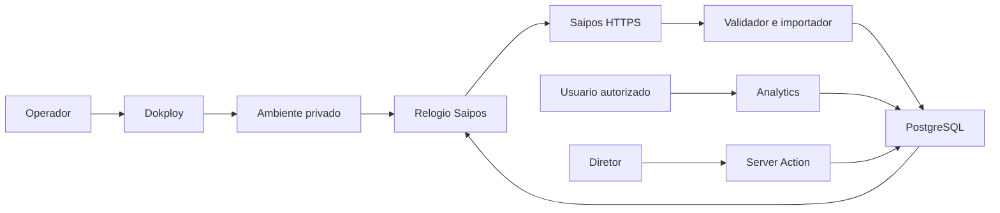

## Executive summary

A integração de vendas Saipos é somente leitura no provedor e preserva o
isolamento por organização/unidade. Os riscos principais são vazamento do token
no canal administrativo, mistura de lojas e corrupção de totais por duplicação
ou cursor avançado após falha. A publicação e a configuração privada ainda
dependem de backup verificado e acesso administrativo protegido.

## Scope and assumptions

- Escopo: src/connectors/saipos, src/modules/analytics, rotas analytics,
  instrumentation e migration saipos_vendas.
- Fora do escopo: importar financeiro/estoque, mudar Auth.js, permissões ou MCP.
- O usuário confirmou: somente Matriz; manter acessos existentes de Analytics;
  não conceder permissões e não escrever no Saipos.
- Produção observada: VPS com Dokploy, Next.js/Prisma 7, PostgreSQL privado.
- Consulta administrativa confirmou Matriz ativa e token Saipos ausente.
- O painel Dokploy observado usa HTTP, com HTTPS desligado; não inserir segredo
  nessa conexão. Backup/restauração ainda não confirmados.
- Questões abertas: canal protegido para configuração; destino e restauração
  do backup; outros consumidores do limite Saipos no mesmo IP.

## System model

### Primary components

- Interface e sessão: src/core/sessao/contexto.ts, núcleo de permissões e
  src/app/(shell)/analytics/vendas/page.tsx.
- Consulta agregada: src/modules/analytics/services/vendas.ts.
- Importador e relógio: src/connectors/saipos/sincronizar.ts e src/instrumentation.ts.
- PostgreSQL: src/server/db.ts e prisma/schema/saipos.prisma.
- Build/deploy: Dockerfile e docker-entrypoint.sh; migrate deploy precede o servidor.

### Data flows and trust boundaries

- Operador → Dokploy → ambiente: token e IDs administrativos; canal observado HTTP
  não oferece confidencialidade de transporte. TLS/SSH é pré-condição operacional.
- Relógio → Saipos: GET HTTPS, Bearer em header; base fixa, sem redirects,
  timeout e tentativas finitas; validação Zod em client.ts.
- Saipos → importador → banco: campos operacionais permitidos; normalizar.ts
  rejeita loja diferente e valores fora do contrato; não persiste dados pessoais.
- Banco → sessão autorizada → Analytics: filtro de organização/unidades,
  analytics.ver e ausência de cobertura distinta de zero.
- Diretor → Server Action → solicitação persistida: sessão, unidade visível,
  analytics.ver, ehDiretor e proteção de origem das Server Actions do Next.
- Developer → build → imagem: sem segredos; migrations aditivas; execução
  Node sem privilégios conforme Dockerfile.

#### Diagram

## Assets and security objectives

| Ativo              | Motivo                                 | Objetivo |
| ------------------ | -------------------------------------- | -------- |
| Token Saipos       | Acesso aos dados das lojas autorizadas | C        |
| Vendas e totais    | Decisões operacionais e conciliação    | C/I      |
| Vínculo de unidade | Limite de segregação                   | C/I      |
| Cursor e lease     | Recuperação e execução única           | I/A      |
| Banco e backup     | Continuidade do sistema existente      | I/A      |
| Auditoria          | Rastreabilidade das mudanças           | I        |

## Attacker model

### Capabilities

Usuário autenticado pode alterar filtros de datas e tentar acessar Analytics.
Terceiro na rede pode observar tráfego administrativo HTTP. Fornecedor
comprometido pode responder com dados incorretos ou excessivos.

### Non-capabilities

Usuário comum não controla o ambiente da VPS, não escolhe loja externa por URL
e não solicita sincronização sem papel de diretor. Não há endpoint de importação
público. Alterar diretamente o PostgreSQL exige credenciais de administrador.

## Entry points and attack surfaces

| Superfície         | Acesso                  | Fronteira        | Controle                          | Evidência                                    |
| ------------------ | ----------------------- | ---------------- | --------------------------------- | -------------------------------------------- |
| Datas Analytics    | Requisição autenticada  | Usuário/sistema  | Datas e escopo                    | analytics/vendas/page.tsx; schemas/vendas.ts |
| Solicitação manual | Server Action           | Diretor/worker   | Sessão, papel, unidade, auditoria | analytics/vendas/acoes.ts                    |
| API Saipos         | Resposta externa        | Provedor/sistema | Zod e allowlist                   | client.ts; normalizar.ts                     |
| Variáveis          | Operação administrativa | Operador/VPS     | Referência de segredo             | .env.example; configurarVinculo              |
| Gravação/cursor    | Worker                  | Processo/banco   | Transação e fencing               | sincronizarVendas                            |
| Deploy             | GitHub/Dokploy          | Código/banco     | Migration aditiva                 | Dockerfile; migration.sql                    |

## Top abuse paths

1. Intermediário observa painel HTTP → intercepta token digitado → consulta
   dados autorizados do Saipos.
2. Usuário tenta trocar unidade no filtro → se o servidor confiasse no ID
   enviado, obteria dados de outra loja; escopo derivado da sessão recusa.
3. Worker antigo termina depois de outro → sobrescreve vendas/cursor; lease,
   fencing e data do provedor impedem o commit ou a regressão.
4. Falha após algumas vendas → cursor avança e perde alterações; transação
   atômica impede confirmação parcial.
5. Resposta externa contém cliente/endereço → payload bruto vai a log ou banco;
   Zod e normalização copiam somente campos operacionais.
6. Deploy sem backup ou migration compatível → indisponibilidade/dados em risco;
   impedir ativação até backup verificado e revisão das migrations pendentes.

## Threat model table

| ID     | Fonte                 | Pré-requisito               | Ação                           | Impacto               | Ativos                | Controles existentes                            | Lacunas                                       | Mitigação                                                      | Detecção                                        | Chance | Impacto | Prioridade |
| ------ | --------------------- | --------------------------- | ------------------------------ | --------------------- | --------------------- | ----------------------------------------------- | --------------------------------------------- | -------------------------------------------------------------- | ----------------------------------------------- | ------ | ------- | ---------- |
| TM-001 | Intermediário         | Painel por HTTP             | Interceptar segredo            | Exposição de lojas    | Token/vendas          | Segredo fora do Git; header só para base fixa   | HTTPS administrativo desativado               | Configurar por TLS/SSH antes da ativação                       | Revisar URL/certificado e acesso administrativo | média  | alto    | high       |
| TM-002 | Usuário comum         | Sessão válida               | Forjar unidade                 | Vazamento entre lojas | Vendas/vínculo        | escopoVendas, analytics.ver, FKs compostas      | Não há evidência de RLS nas tabelas novas     | Manter testes de escopo e filtros em toda consulta             | Auditoria e revisão de consultas                | baixa  | alto    | medium     |
| TM-003 | Concorrência/falha    | Dois processos ou queda     | Duplicar ou perder atualização | Faturamento incorreto | Vendas/cursor         | Chave única, transação, lease e fencing         | Lease de 45 min atrasa recuperação            | Monitorar erro/sucesso; solicitar nova execução após expiração | Estado mostrado na tela                         | baixa  | alto    | medium     |
| TM-004 | Provedor comprometido | Resposta malformada         | Introduzir payload/PII         | Exposição ou parada   | Banco/disponibilidade | Zod, normalização, GET fixo, timeout            | JSON não tem teto próprio de bytes            | Monitorar tamanho/tempo e parar em mudança de contrato         | Erro de formato, sem payload bruto              | baixa  | médio   | low        |
| TM-005 | Operação              | Deploy sem recuperação      | Aplicar banco incompatível     | Indisponibilidade     | Banco/backup          | Migration aditiva; deploy do Prisma             | Backup ainda não verificado                   | Backup com teste de restauração antes do deploy                | Logs de deploy e conferência de migrations      | média  | alto    | high       |
| TM-006 | Operador autorizado   | Réplicas/consumidores no IP | Exceder limite Saipos          | Atrasar importação    | Disponibilidade       | Fila local, 700ms, 429 interrompe, 3 tentativas | Limite local não coordena outros processos/IP | Um worker ou limitador distribuído                             | 429 e último erro                               | média  | médio   | medium     |

## Criticality calibration

- critical: exposição pública do token de múltiplas lojas; bypass de sessão
  com acesso irrestrito ao banco. Não identificados no código novo.
- high: token enviado pelo painel HTTP; publicar sem backup recuperável.
- medium: concorrência produzir total incorreto; consumo paralelo atingir 429.
- low: resposta inválida interrompida sem gravar dados; lease atrasar uma
  recuperação manual com dados anteriores preservados.

## Focus paths for security review

| Caminho                                   | Motivo                             | Ameaças        |
| ----------------------------------------- | ---------------------------------- | -------------- |
| src/connectors/saipos/client.ts           | Token, host fixo, timeout, retries | TM-001/004/006 |
| src/connectors/saipos/sincronizar.ts      | Vínculo, chave, cursor e fencing   | TM-002/003     |
| src/modules/analytics/schemas/vendas.ts   | Escopo sem fallback global         | TM-002         |
| src/modules/analytics/services/vendas.ts  | Consultas agregadas autorizadas    | TM-002         |
| src/app/(shell)/analytics/vendas/acoes.ts | Solicitação administrativa         | TM-002/006     |
| prisma/schema/saipos.prisma               | Chaves e segregação                | TM-002/003/005 |
| docker-entrypoint.sh                      | Aplicação das migrations           | TM-005         |

## Notes on use

Escopo confirmado pelo usuário antes deste relatório. Superfícies de leitura,
escrita manual, job, segredo e deploy foram revisadas. Cada fronteira aparece
em uma ameaça; runtime foi separado de build/teste. Controles novos passaram por
testes unitários e verificação SQL isolada; não se afirma deploy ou restauração
na produção. Riscos operacionais abertos permanecem explícitos.

## Revisão incremental: dashboard Bento

Em 25/10/2026 a alteração manteve analytics.ver, escopo de organização/unidade,
GET autenticado ao host fixo e Server Action exclusiva do diretor. A atualização
do navegador apenas renova Server Components autorizados; não enfileira consultas
à origem. Nenhum acesso ou segredo novo é exposto. O worker usa reserva temporal
atômica de 15 minutos e cooldown de 30 minutos após falha, além do lease existente.
Risco residual TM-006 continua restrito a consumidores externos no mesmo IP.
Antes da ativação anterior, backup Tetteo foi restaurado com sucesso em banco
isolado e removido após verificação; cópias local/VPS tiveram hashes conferidos.
O token foi configurado por SSH criptografado. O painel Dokploy permanece HTTP;
não usá-lo para transmitir segredos. TM-001/005 tiveram as mitigações de ativação
executadas, mantendo a melhoria de HTTPS administrativo pendente.
